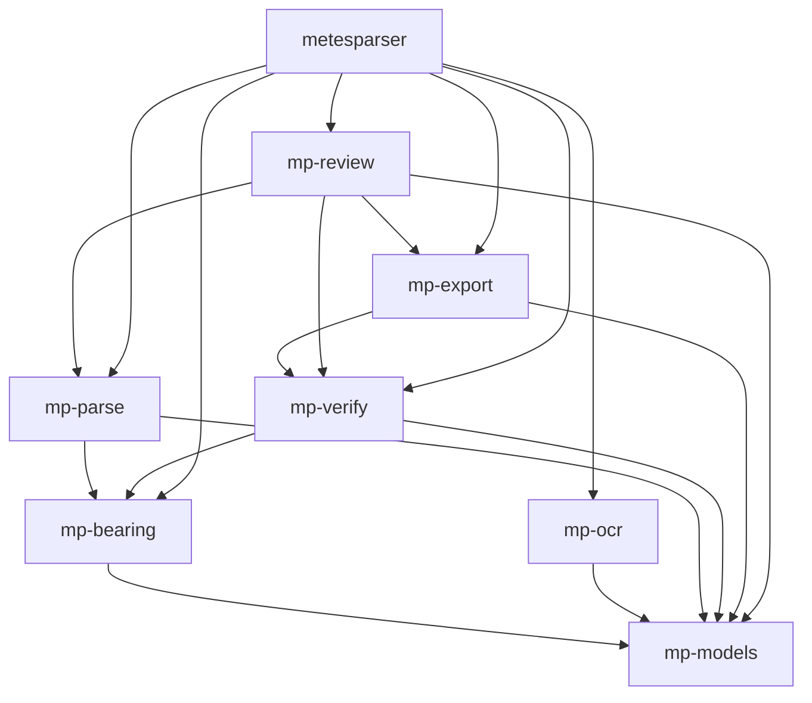
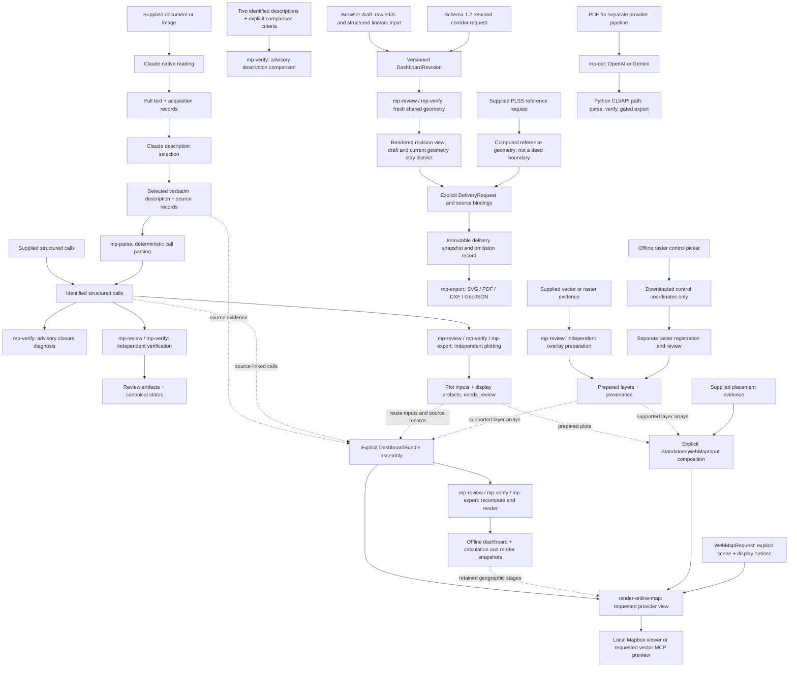

# Architecture

System design and data flow for metesParser.

## Table of Contents

- [System Overview](#system-overview)
- [Core Principles](#core-principles)
- [Composable Package Architecture](#composable-package-architecture)
- [Skill Composition](#skill-composition)
- [Advisory Operations and Artifact Reuse](#advisory-operations-and-artifact-reuse)
- [Revisions, Derived Geometry, and Delivery](#revisions-derived-geometry-and-delivery)
- [Data Flow](#data-flow)
- [Package Details](#package-details)
- [Data Models](#data-models)
- [Verification Pipeline](#verification-pipeline)
- [Error Handling](#error-handling)
- [Performance Considerations](#performance-considerations)
- [Design Decisions](#design-decisions)
- [Concrete Sample Workflow](#concrete-sample-workflow)
- [Optional Geographic Display Architecture](#optional-geographic-display-architecture)

## System Overview

metesParser combines source acquisition with deterministic metes-and-bounds parsing, canonical verification, advisory analysis, and review views. Verified CSV is conditional on the export gate; source validity and display results remain separate.

### Key Characteristics

- **Rule-based parsing** - Numerical call parsing is deterministic; source reading uses `mp-ocr` in the Python pipeline or Claude's native capabilities in the plugin.
- **Deterministic analysis** - The same prepared calls and explicit parameters produce the same numerical results; model reading is a separate source-evidence stage
- **Verification-first** - `_verified.csv` requires fresh canonical verification of the actual exported calls
- **Never fabricates** - Flags incomplete data rather than guessing
- **Composable** - 8 independently installable packages, each does one thing well

### Technology Stack

- **Python 3.11+** - Modern Python with type hints (`|` unions)
- **Pydantic v2** - Data validation and schema enforcement
- **OpenAI + optional Gemini** - Configurable LLM providers for PDF extraction
- **UV workspace monorepo** - 8 composable packages (no pip/conda/poetry)
- **pytest** - Root, package/plugin, and opt-in browser suites; scope and commands are in [TESTING.md](TESTING.md)

## Core Principles

### 1. Never Fabricate Data

```python
# NEVER do this:
if bearing is None:
    bearing = "estimate based on adjacent calls"  # WRONG

# ALWAYS do this:
if bearing is None:
    call = call.model_copy(update={
        "bearing_azimuth_deg_from_north": None,
        "notes": "incomplete bearing - cardinal only",
    })
```

### 2. Verification Before Export

```python
result = ClosureChecker.verify_closure(calls)

if result.is_fully_verified():
    CSVBuilder.export_verified_csv(calls, result, output_path, legal_desc=legal_desc)
else:
    print(f"Cannot export verified CSV: {result.misclosure_ft:.4f} ft misclosure")
```

### 3. Preserve Original Wording

```python
# Keep deed language verbatim in descriptive fields
call = DeedCall(
    course=1,
    direction_text="S 56 40' W",
    bearing_quadrant="S 56 40' W",
    distance_ft=125.0,
    along="the division line between Lots 46 and 47",  # Preserve exact wording
    to="the corner to Lot 50",  # Preserve exact wording
)
```

### 4. Deterministic Analysis and Auditable Reading

Parsing, bearing math, verification, diagnosis, and comparison are deterministic. Provider settings do not guarantee repeatable or accurate model extraction. Enable extraction audit (for example, `Pipeline(audit=True)`) to retain provider prompts/responses and processing context; retain acquisition/selection evidence when using native Claude reading. Cached responses preserve a particular extraction, not proof of its truth.

## Composable Package Architecture

The codebase is a **uv workspace monorepo** with 8 independently installable packages: seven `mp-*` packages and the root `metesparser` package:

```
packages/
  mp-models/    -> Shared schemas, evidence/analysis contracts, units, logging
                  (no workspace package dependencies)
  mp-bearing/   -> Pure math: azimuth, curves, deltas (depends: mp-models)
  mp-ocr/       -> LLM boundary: PDF -> text (depends: mp-models)
  mp-parse/     -> Rule-based parsing: text -> calls (depends: mp-models, mp-bearing)
  mp-verify/    -> Canonical checks + plot/relative/diagnosis/comparison math
                  (depends: mp-models, mp-bearing)
  mp-export/    -> CSV, audit, plot/dashboard rendering (depends: mp-models, mp-verify)
  mp-review/    -> File/CLI adapters, evidence validation/replay, analysis and views
                  (depends: mp-models, mp-parse, mp-verify, mp-export)
src/metesparser/ -> Orchestrator + backward-compat monolith
```

### Dependency Graph

Arrows show workspace dependencies (external libraries omitted):



### Package-to-Monolith Mapping

The original monolith in `src/metesparser/` is preserved for backward compatibility. Corresponding legacy implementations must stay in sync. New review capabilities use thin facades rather than duplicate engines.

| Package | Monolith Module(s) |
|---------|-------------------|
| `mp-models` | `models.py` |
| `mp-bearing` | `bearing_converter.py` |
| `mp-ocr` | `pdf_processor.py`, `llm_clients.py`, `llm_cache.py` |
| `mp-parse` | `call_extractor.py`, `text_parser.py` |
| `mp-verify` | `closure_checker.py` |
| `mp-export` | `csv_builder.py`, `audit_reporter.py` (legacy CSV/audit functionality) |
| Shared review/analysis APIs | `plot.py`, `dashboard.py`, `source_handoff.py`, `artifact_inspect.py`, `diagnostics.py`, `comparison.py`, `corridor.py`, `plss.py`, `revisions.py`, `delivery.py`, and `raster_picker.py` re-export package implementations/contracts |
| `metesparser` | `pipeline.py`, `cli.py`, `run_registry.py`, `review_packet.py` |

### Pipeline Orchestrator

`Pipeline.run()` extracts and parses a PDF, then returns canonical verification results and an optional audit context:

```python
from pathlib import Path
from metesparser import Pipeline

pipe = Pipeline(provider="openai", cache=True, audit=True)
result, audit_ctx = pipe.run(Path("deed.pdf"))
```

It currently wraps the monolith `PDFProcessor` for backward compatibility and uses shared verification. Multi-tract input returns a list of results. `Pipeline.run()` does not write CSV or audit files; the CLI/export APIs own file publication and the fresh verified-export gate.

## Skill Composition

The [plugin catalog](../plugins/metesparser/README.md) describes thirteen skill entrypoints: ten capabilities, two workflows, and the `review-deed` compatibility alias. Capabilities cover document transcription, description selection, verification, plotting, overlays, corridor construction, PLSS reference preparation, review-package export, online rendering, and description comparison. Source validation, artifact inspection, and closure diagnosis are shared utilities. Skills route work across packages; their [artifact handoff contract](../plugins/metesparser/references/artifact-handoffs.md) defines accepted inputs, stopping points, source identity, invalidation, and status boundaries. See [maintain the skill composition](CLAUDE_PLUGIN.md#maintain-the-skill-composition) for documentation ownership.



Verification and plotting each accept identified structured calls independently. Plotting does not require a passing verification result and remains advisory (`needs_review`). Overlay preparation is independent of deed geometry and returns layer/provenance artifacts; it does not align a deed. Capability skills stop at their requested deliverable. The boundary-review workflow composes source preparation, selection, and deterministic review as needed; it does not automatically build a plot or dashboard.

Dashboard creation is an explicit composition step: assemble source-linked calls and calculation records in a `DashboardBundle`, reuse plot inputs with their actual source records, and copy supported map-layer arrays into the corresponding bundle fields. The dashboard command does not automatically adapt standalone artifacts. It recomputes geometry under dashboard identities; a later requested placement must bind a supplied transform to the fresh dashboard geometry hash. It never infers alignment. See the [bundle composition mapping](../plugins/metesparser/skills/deed-closure-dashboard/references/dashboard-bundle.md#compose-existing-plot-and-map-artifacts).

A map-only request composes existing `PreparedPlot` objects, map layers, and explicit placements in `StandaloneWebMapInput`, then supplies a separate `WebMapRequest` to `render-map`. It revalidates shared geometry and placement bindings without requiring dashboard assembly. See the [standalone composition recipe](../plugins/metesparser/skills/render-online-map/references/local-viewer.md#compose-existing-artifacts).

Claude's native reading and selection are source-preparation stages outside the Python provider pipeline. The plugin does not substitute `mp-ocr` or an external OCR service for native reading. In the separate Python PDF pipeline below, `mp-ocr` owns OpenAI/Gemini calls. In both paths, parsing, geometry, checks, and rendering use deterministic package code; geometric success does not establish source completeness.

Browser edits are recoverable working copies. The straight-course scenario calculator is a preview; the structured editor retains exact raw line/arc inputs, but shared-engine geometry is refreshed only after publishing and rendering a revision. A browser preview, saved raw draft, or last-valid parent plot is not the current geometry for an unresolved revision.

## Advisory Operations and Artifact Reuse

| Operation | Contract and responsibility | Meaning and limits |
| --- | --- | --- |
| Source validation | `mp_models.source_handoff` schema `1.1`; `mp_review.source_handoff.validate_source_bundle()` | Read-only structural, identity and uncertainty outcomes. Reconstructs selected UTF-8 spans byte for byte, preserves BOM/CRLF and explicit separators, confines paths to the supplied root, and retains unknown hashes/pages. Legacy `1.0` stays unverifiable. |
| Artifact inspection | `mp_models.artifact_inspection`; `mp_review.artifact_inspect.inspect_artifacts()` | Discovers known artifacts under an explicit directory, replays deterministic source inputs, validates declared dependencies and returns causal restart guidance. Artifact usability is separate from stored canonical status. No workflow is executed. |
| Closure diagnosis | `mp_models.diagnostics`; `mp_verify.diagnostics.diagnose_closure()` | Complete straight-boundary sensitivities, with distance and angle units kept separate. Missing bearings and unsupported geometry remain explicit. Precision bounds require source precision and a rounding assumption; neither ranking nor a scenario selects a correction. |
| Description comparison | `mp_models.comparison`; `mp_verify.comparison.compare_descriptions()` | Explicit straight pairs/reversed traversals or contiguous collinear groups, plus tentative content differences and split/merge suggestions. Direction needs compatible documented basis and units or a sourced rigid transform; position also needs validated common scene/placements. No automatic alignment or legal-boundary claim. |

These operations are exposed by `metes-review` and the packaged launcher:

```sh
uv run metes-review validate-source BUNDLE_DIR
uv run metes-review inspect-artifacts BUNDLE_DIR --requested-stage dashboard
uv run metes-review diagnose-closure diagnosis-request.json --output-dir diagnostics-new
uv run metes-review compare-descriptions comparison-request.json --output-dir comparison-new
```

`validate-source` and `inspect-artifacts` do not write to their input folders or create a configured output directory. File-producing diagnosis/comparison commands require a new output directory, retain exact request bytes, and write result plus versioned identity manifests. Complete request examples are linked from [source preparation](../plugins/metesparser/references/source-preparation.md), [closure diagnosis](../plugins/metesparser/references/closure-diagnostics.md), and [comparison limits](../plugins/metesparser/references/comparison-limits.md).

Completed advisory commands return `needs_review` / exit **1**, even when every requested component is usable or agrees. Invalid invocation/schema returns `error` / exit **2**. Canonical review/verification may return `checks_passed` / exit **0**. Source validation, artifact freshness, diagnostic availability and comparison agreement cannot substitute for canonical verification or authorize verified export.

The inspector follows declared IDs/hashes rather than filenames or timestamps. Review replay uses the recorded original input kind, stated-area option and algorithm version, even when CSV/JSON bytes are retained as `source.txt`. Source/call changes invalidate their dependent stages; map/placement changes affect only dependent positioning/rendering work; viewer opacity, raster order and viewport are presentation state. Optional maps are outside closure-only requests. Reasons/dependencies remain visible at artifact and stage levels; ambiguous occurrences do not produce a guessed restart command.

Dashboards retain fresh baseline diagnosis and comparison stages separately from canonical findings, with input/output hashes checked against immutable source-owned calls. Scenario edits/reset operate on a separate browser copy. Integrated comparison regeneration uses the retained `DashboardBundle` and its specifications; it does not assume a standalone comparison request exists. Standalone diagnosis/comparison also work without a dashboard or native document reading.

## Revisions, Derived Geometry, and Delivery

`mp_models.revisions` defines baseline-bound alternatives; `mp_review.revisions` imports, prepares, publishes, and replays them; `mp_export.revision_html` renders a fresh revision view. Revision schema `1.0` supports the base form, `1.1` adds structured course editing, and `1.2` adds retained corridor definitions. The browser's local draft store preserves incomplete raw values and does not establish publication or geometry. Structured line, circular-arc, and annotation edits retain their exact strings and stable call/tract/document identities. After a draft is saved, `render-revision` recomputes shared-engine geometry and keeps current geometry distinct from explicitly labeled last-valid parent geometry. Unsupported or incomplete edits remain recoverable drafts; they do not borrow old geometry as current.

Published revisions are immutable, baseline-hash-bound records. A retry can complete an interrupted publication only with identical content. Loading a revision replays its declared artifacts and compares them with fresh deterministic results. Changes invalidate dependent placements, comparisons, exports, and canonical verification; a source correction records supplied excerpts and revised calls but does not fabricate an acquisition or selection record. Saving or rendering an alternative does not run canonical verification or grant verified-export eligibility.

Corridors are constructed from an explicit centerline `PlotRequest`, ordered width intervals, endpoint widths, step/taper rules, join/cap choices, source references, and a declared error budget. `mp_verify.corridor` owns the geometry and topology checks; `mp_review.corridor` owns standalone request/result files. A schema `1.2` revision retains the exact corridor request bytes as JSON text and replays them into separate centerline and boundary plots. Child revisions retain the full corridor ID inventory; removal is an explicit tombstone retaining the original definition, and edits recompute derived geometry. Unsupported topology or exceeded budgets do not yield an apparently complete polygon. Corridor geometry is advisory and never becomes a deed call or canonical verification result. See the [corridor capability](../plugins/metesparser/skills/plot-corridor/SKILL.md) and [revision contract](../plugins/metesparser/references/revisions.md#saved-corridor-definitions).

PLSS derivation is similarly a supplied-reference computation. The request identifies a dataset version, cited authority, projected scene, section key, specific reference, and supported rectangular-aliquot rule. `mp_verify.plss` computes only from those supplied corners and retains dataset/reference/source hashes; `mp_review.plss` validates and replays its producer files. A PLSS recital alone cannot create nominal section dimensions or corners. The result is reference/context geometry, not a legal boundary, source attestation, or canonical verification. Projected-scene support uses optional geographic dependencies; the no-geo runtime explicitly reports the missing `mp-review[geo]` prerequisite. See the [PLSS reference capability](../plugins/metesparser/skills/plot-plss-reference/SKILL.md).

`DeliveryRequest` selects a published revision, geometry version, layers, formats, units, coordinate mode, placements, and presentation options. `mp_review.delivery` freshly replays the revision and any bound corridor/PLSS sources, checks their manifest/input/geometry identities, and freezes the accepted membership, transforms, metrics, and omissions in a `DeliverySnapshot`. `mp_export.delivery` renders requested SVG, PDF, DXF, and geographic GeoJSON; `publish_delivery` writes immutable artifacts with its manifest last, while `load_delivery` replays and validates the package. PDF/DXF runtime dependencies are bundled in both plugin profiles; geographic projection dependencies remain optional.

Representation limits are explicit in the snapshot and manifest. DXF/GeoJSON omit drawn labels and presentation rotation while retaining source properties/sidecars; raster layers cannot be embedded in CAD/GIS outputs and are refused when the layer or requested appearance is required. GeoJSON requires an explicitly projected scene and placed coordinates. A revision-bound corridor source must identify the selected revision's actual manifest hash, corridor input hash, boundary geometry hash, and boundary layer ID. Corridor placement binds the original centerline placement, then composes the stored boundary origin once. PLSS export retains the reference's original scene rather than applying a deed placement. Source bytes are omitted unless full-source inclusion is requested; hashes and explicit omission remain recorded. These exports remain advisory and set neither canonical verification nor verified-export eligibility. See [review-package export](../plugins/metesparser/skills/export-review-package/SKILL.md).

Raster picking is a separate evidence step. `pick-raster` creates an offline pixel-control UI and retains the original image and control input; downloading points does not fit a registration or place a deed. A later registration command validates the controls and computes fit and any supplied independent checkpoint residuals. Raster registration, deed placement, and map rendering are separate dependencies: registration does not imply deed alignment, a good fit residual does not replace checkpoint evidence, and display controls do not alter geometry. See the [raster preparation reference](../plugins/metesparser/skills/prepare-parcel-overlay/references/overlay-preparation.md#optional-native-pixel-control-picker).

The principal local commands for these handoffs are:

```sh
uv run metes-review revision-template BUNDLE.json --output NEW_DRAFT.json
uv run metes-review save-revision BUNDLE.json --revision DRAFT.json --output-dir REVISION_STORE
uv run metes-review inspect-revision BUNDLE.json --revision-dir REVISION_DIR
uv run metes-review render-revision BUNDLE.json --revision-dir REVISION_DIR --output-dir NEW_VIEW
uv run metes-review analyze-corridor REQUEST.json --output-dir NEW_CORRIDOR_DIR
uv run metes-review derive-plss REQUEST.json --output-dir NEW_REFERENCE_DIR
uv run metes-review pick-raster IMAGE --controls CONTROLS.json --output-dir NEW_PICKER_DIR
uv run metes-review register-raster IMAGE --controls CONTROLS.json --output NEW_LAYER.json
uv run metes-review export-review BUNDLE.json --revision-dir REVISION_DIR --request REQUEST.json --output-dir NEW_PACKAGE_ROOT
uv run metes-review inspect-delivery BUNDLE.json --revision-dir REVISION_DIR --package-dir PACKAGE_DIR
```

The plugin launcher has matching subcommands. A complete local/extracted runtime check is not native Claude/Cowork acceptance; actual document reading, paired skill behavior, browser/host behavior, and live providers require separate observed gates in the [implementation ledger](implementation/2026-10-28-cowork-workflow-ledger.md).

## Data Flow

### Provider-Backed PDF Pipeline

```
PDF -> mp-ocr -> mp-parse -> mp-verify -> mp-export
       LLM       Rules       Checks      _verified.csv
       extract    extract     closure     .audit.json
                  calls       area        .audit.html
```

### Detailed Flow

```
1. PDF Extraction [mp-ocr]
   |-> Configured LLM provider (OpenAI or Gemini)
   |-> Retain provider output; sampling settings do not prove repeatability or accuracy
   |-> File-based response caching (CachedLLMClient)
   |-> LLM confidence scoring (7 heuristic signals)
   '-> Returns: Raw legal description text

2. Text Normalization [mp-parse]
   |-> Fix OCR errors (5outh -> South, Ea5t -> East)
   |-> Merge wrapped lines (div-\nision -> division)
   |-> Standardize cardinal directions (South -> S)
   '-> Returns: Normalized text

3. Metadata Extraction [mp-parse]
   |-> POC/POB (Point of Commencement / Point of Beginning)
   |-> PLSS metadata (Section/Township/Range/PM/aliquot)
   |-> Area statement, basis of bearing, surveyor certification
   |-> Prior conveyance, subdivision reference, witness trees
   |-> Coordinate system + FIPS code
   '-> Returns: Populated LegalDescription fields

4. Call Extraction [mp-parse]
   |-> Split calls by numbered markers, THENCE, or semicolons
   |-> Parse bearing (quadrant format)
   |-> Parse distance + unit (feet, chains, varas, etc.)
   |-> Parse curve parameters (R, delta, L)
   |-> Extract along/to descriptive fields
   |-> Classify monuments and monument status
   '-> Returns: List[DeedCall]

5. Bearing Enrichment [mp-parse + mp-bearing]
   |-> Convert quadrant -> azimuth
   |-> Calculate curve properties
   |-> Mark tie-in calls (POC-to-POB)
   '-> Returns: Enriched DeedCall objects

6. Closure Verification [mp-verify]
   |-> Compute traverse (calculate all points)
   |-> Record structured canonical check outcomes
   |-> Calculate area, perimeter, misclosure
   |-> Score per-call quality and overall confidence
   '-> Returns: ClosureResult

7. CSV Export [mp-export]
   |-> If fully verified: export _verified.csv
   |-> Else: export regular .csv with warnings
   '-> If audit_context provided: write .audit.json + .audit.html sidecars

8. Audit Sidecar (optional) [mp-export]
   |-> AuditContext threads through pipeline (created before extraction)
   |-> Captures: LLM confidence, source excerpts, transformations, decisions
   |-> .audit.json: canonical audit data store
   '-> .audit.html: self-contained report with collapsible sections, confidence colors
```

## Package Details

### mp-models

**Purpose**: Shared schemas, units, logging and validation; no workspace package dependencies. External dependencies include Pydantic and structlog.

**Key Types**:
- `DeedCall` - Single course with bearing, distance, curve data, and metadata
- `LegalDescription` - Complete deed with calls list + metadata fields
- `ClosureResult` - Verification results with misclosure, area, confidence scoring
- `AuditContext` - Mutable accumulator for audit trail (NOT frozen)
- `CallAudit`, `Transformation`, `Decision` - Per-call audit details
- `RawTextMessage`, `LegalDescriptionMessage`, `ClosureResultMessage` - JSONL envelope types
- `ConversionFactors`, `DistanceUnit` - Unit conversion constants
- Source acquisition/selection, artifact inspection, diagnosis and comparison contracts
- Dashboard, plot, scene/placement, raster, web-map, revision, corridor, PLSS reference, and delivery contracts

### mp-bearing

**Purpose**: Pure coordinate math with no I/O

**Key Functions**:
- `parse_quadrant_bearing()` - Parse "S 56 40' W" -> (S, 56.667, W)
- `quadrant_to_azimuth()` - Convert to degrees from North
- `calculate_curve_properties()` - Compute L, chord from R, delta
- `calculate_deltas()` - Compute dx, dy from azimuth, distance
- `parse_packed_dms()` - Parse packed DMS (46.1631 -> 46.2753 degrees)
- `calculate_missing_curve_elements()` - Any 2+ elements -> all 5

**Formulas**:
```
Quadrant to Azimuth:
  N x E -> az = x
  S x E -> az = 180 - x
  S x W -> az = 180 + x
  N x W -> az = 360 - x

Curve: L = R * delta (radians), chord = 2R * sin(delta/2)
Deltas: dx = dist * sin(az), dy = dist * cos(az)
```

### mp-ocr

**Purpose**: LLM provider boundary for the Python PDF pipeline. Native plugin reading is outside this package.

**Key Classes**:
- `PDFProcessor` - Extracts text from deed PDFs via LLM
- `BaseLLMClient` ABC, `OpenAIClient`, `GeminiClient` - Provider implementations
- `CachedLLMClient` - Disk-cached wrapper for LLM responses
- `compute_llm_confidence()` - 7 weighted heuristic signals, 0.0-1.0

### mp-parse

**Purpose**: Rule-based parsing (regex, NOT AI)

**Key Functions**:
- `extract_calls()` - Parse full description -> List[DeedCall]
- `extract_single_call()` - Parse one call
- `enrich_calls_with_azimuths()` - Add missing azimuths
- `mark_tie_in_calls()` - Flag POC-to-POB calls
- `classify_monument()`, `classify_monument_status()` - Monument classification
- Metadata: `extract_plss_metadata()`, `extract_poc_and_pob()`, `extract_area_statement()`, `extract_basis_of_bearing()`, etc.

### mp-verify

**Purpose**: Canonical geometric checks plus shared plot/relative geometry and advisory diagnosis, comparison, corridor, and supplied-reference math.

**Verification Checks**:
1. **Traverse Closure** - Misclosure < 0.01 ft by default
2. **Interior Angles** - Sum = (n-2)*180 degrees
3. **Parallelism** - "continuing" lines match
4. **Curve Math** - L ~ R*delta, chord ~ 2R*sin(delta/2)
5. **Area Check** - Flags if computed area differs >5% from stated
6. **Double Entry** - Optional comparison if second call set supplied
7. **Bearing Reversal** - Adjacent courses ~180 degrees apart
8. **Distance Reasonableness** - Flags <0.5 ft, >10x median, >90% perimeter
9. **Boundary Topology** - Intersections in supported straight and circular-arc boundaries

**Key Functions**:
- `verify_closure()` - Main verification entry point
- `calculate_confidence_score()` - 0.0-1.0 weighted score
- `score_call_quality()` - Per-call high/medium/low
- `get_closure_summary()` - Human-readable summary
- `diagnose_closure()`, `compare_descriptions()` - Separate advisory analyses; do not modify verification tolerances or calls
- `analyze_corridor()` - Build an explicitly parameterized centerline ribbon with source-linked width intervals, topology outcomes, and an error budget
- `derive_plss()` - Apply the supported rectangular aliquot rule only to an identified supplied section reference

### mp-export

**Purpose**: CSV/audit output and standalone plot, dashboard, revision, delivery, and online-map rendering.

**Key Functions**:
- `export_verified_csv()` - Recheck exact calls and export only when canonical outcomes are eligible
- `calls_to_csv()`, `csv_to_calls()`, `csv_text_to_calls()` - CSV I/O and retained-byte replay
- `generate_html()`, `write_report()` - Audit HTML report
- `plot_html.py`, `plot_svg.py`, `dashboard_html.py`, `revision_html.py`, `delivery.py`, `raster_picker.py`, `online_map_html.py` - Display and delivery renderers

**CSV Schema** (21 fields):
```csv
course,direction_text,bearing_quadrant,bearing_azimuth_deg_from_north,distance_ft,curve_dir,radius_ft,delta_deg,arc_length_ft,chord_bearing,chord_length_ft,along,to,monument_type,monument_status,is_exception,is_meander,is_tie_in,non_tangent,radial_bearing,notes
```

### mp-review

**Purpose**: Deterministic file/API orchestration and the `metes-review` CLI, without LLM provider calls.

- `api.py`: review/verification adapters and `replay_review()`; producer manifests retain input kind, parameters, versions, exact source bytes and output identities.
- `source_handoff.py`, `artifact_inspect.py`: read-only source validation and conditional artifact replay/resume guidance.
- `diagnostics.py`, `comparison.py`: exact-input file adapters over shared advisory engines.
- `corridor.py`, `plss.py`: exact-request producers and replay for derived corridor and supplied PLSS reference geometry.
- `revisions.py`, `revision_view.py`: baseline-bound, immutable revision publication/replay and fresh shared-engine views.
- `delivery.py`: typed selection, source-binding validation, immutable package publication/replay, and recorded omissions.
- `raster_picker.py`: offline control-point collection; registration remains a separate operation.
- `plot.py`: `plot_file()` loads structured input and writes standalone plot artifacts without canonical verification.
- `dashboard.py`: `prepare_dashboard()` and `dashboard_file()` validate bundles, coordinate calculation/cache stages, and write dashboard snapshots.
- `overlays.py`, `raster_registration.py`, `parcel_provider.py`: vector import, supplied raster registration, and explicitly requested parcel retrieval/preparation.

Shared input contracts live in `mp_models`. `mp_verify` owns numerical analysis and pure geometry/provenance validation; `mp_export` owns serialization and HTML/SVG rendering. `mp-review` coordinates file, CLI and optional provider adapters rather than duplicating their engines. It makes no LLM calls; explicitly requested parcel retrieval and connected map viewing have separate network boundaries. Native transcription and selection remain Claude skill responsibilities.

## Data Models

### DeedCall

Core data structure representing one deed call:

```python
class DeedCall:
    course: int                                    # Sequential number (1, 2, 3...)
    direction_text: str                            # Raw direction text
    bearing_quadrant: str | None                   # "S 56 40' W"
    bearing_azimuth_deg_from_north: float | None   # 236.667 (degrees from N)
    distance_ft: float                             # Distance in feet (must be > 0)

    # Curve fields (all None for straight lines)
    curve_dir: str | None                          # "left" or "right"
    radius_ft: float | None                        # Curve radius
    delta_deg: float | None                        # Central angle
    non_tangent: bool                             # Non-tangent curve flag
    radial_bearing: str | None                    # Radial bearing (if non_tangent)
    arc_length_ft: float | None                    # Arc length
    chord_bearing: str | None                      # Chord bearing
    chord_length_ft: float | None                  # Chord length

    # Descriptive fields
    along: str | None                              # "along the division line"
    to: str | None                                 # "to an iron pin"
    monument_status: str | None                    # Found/set monument status
    monument_type: str | None                      # Survey marker type
    is_exception: bool                             # EXCEPT/LESS AND EXCEPT marker
    is_meander: bool                               # Water boundary (meander line)
    is_tie_in: bool                                # Tie-in call between POC and POB
    is_indefinite: bool                            # Vague direction without precise bearing
    curve_type: str | None                         # simple/compound/reverse; spiral is explicitly unsupported geometry
    notes: str | None                              # Warnings/flags
```

### ClosureResult

Verification results:

```python
class ClosureResult:
    misclosure_x_ft: float                     # X component of misclosure
    misclosure_y_ft: float                     # Y component
    misclosure_ft: float                       # Total misclosure
    area_sq_ft: float                          # Computed area
    area_acres: float                          # Area in acres
    perimeter_ft: float                        # Total perimeter
    precision_ratio: float | None              # Misclosure / perimeter ratio
    confidence_score: float | None             # Optional 0.0-1.0 heuristic, not source accuracy

    closure_passed: bool                       # Misclosure < tolerance?
    angle_check_passed: bool                   # Angles sum correctly?
    curve_consistency_passed: bool             # Curve math correct?

    warnings: list[str]                        # List of warnings
    points: list[Point]                        # All traverse points
    checks: list[CheckResult]                  # passed/failed/not_applicable/blocked + reason

    def is_fully_verified(self) -> bool:
        """Check engine geometry eligibility independently of source review."""
```

## Verification Pipeline

### Traverse Computation

Use `mp_verify.verify_closure()` for canonical results and `mp_verify.plot.prepare_plot()` for source-linked display geometry. Both use shared bearing/curve math; their outputs have different meanings. Tie-in calls are explicitly excluded from boundary geometry. Missing orientations and unsupported connectivity remain blocked/unresolved rather than proving a complete boundary from known calls alone. Plotting may retain a valid prefix, but it cannot authorize verified export.

For a supported straight course, `delta E = distance × sin(azimuth)` and `delta N = distance × cos(azimuth)`, with azimuth clockwise from north. Supported circular arcs use radius, sweep and explicit orientation evidence. The exporter re-runs canonical verification on the exact calls and rejects stale/mismatched results. Closure below 0.01 ft is necessary, but eligible applicable outcomes and no warnings are also required; `not_applicable` never means a check was performed.

### Area Calculation

Straight boundaries use the shoelace formula. Supported circular boundaries include analytic arc contributions rather than treating arc endpoints as a replacement chord. Open-traverse display/scenario area can include an implicit closing segment and remains provisional; it is not evidence that the recorded boundary closes. Exception and multi-tract handling use the canonical verifier's explicit tract semantics.

## Error Handling

### Input Validation

Pydantic enforces constraints at construction:

```python
class DeedCall(BaseModel):
    distance_ft: float = Field(gt=0)  # Must be > 0

# This raises ValidationError:
DeedCall(course=1, direction_text="North", distance_ft=0.0)
DeedCall(course=1, direction_text="North", distance_ft=-10.0)
```

### Graceful Degradation

Handle incomplete data without crashing:

```python
if parsed_bearing is None:
    call = call.model_copy(update={
        "bearing_azimuth_deg_from_north": None,
        "notes": "incomplete bearing - cardinal only",
    })
    # Retain the unresolved reading; do not infer a numeric direction.
```

### Verification Warnings

Verification warnings remain visible and prevent verified-export eligibility; unavailable checks have explicit reasons:

```python
warnings = []
if misclosure > tolerance:
    warnings.append(f"Misclosure {misclosure:.4f} ft exceeds tolerance")
return ClosureResult(..., warnings=warnings)
```

## Performance Considerations

### Fast Operations

- **Text parsing**: Regex-based, very fast (~ms)
- **Bearing conversion**: Pure math, no I/O
- **Traverse computation**: O(n) where n = number of calls
- **Area calculation**: O(n) shoelace formula

### Slow Operations

- **PDF extraction**: Provider latency varies with document and service
- **Large parcels**: 100+ calls take longer to verify

### Optimization Strategies

1. **LLM response caching** - `CachedLLMClient` avoids re-extracting the same PDF
2. **Batch processing** - Process multiple PDFs in sequence (significantly faster with LLM response cache)
3. **Independent plotting** - Request an advisory plot when only a view is needed; this produces no verification claim

## Design Decisions

### Why Composable Packages?

**Decision**: Keep focused packages independently installable; `mp-review` extends the original seven-package split to eight with deterministic CLI and artifact orchestration.

**Rationale**:
- **Unix philosophy** - Each package does one thing well
- **Independent installation** - Install/test only the required workspace packages using uv
- **Clear boundaries** - Only `mp-ocr` calls LLMs; everything else is deterministic
- **Testable in isolation** - Per-package test suites

**Trade-off**: Dual maintenance (packages + monolith for backward compat), but cross-package import tests prevent drift.

### Why Rule-Based Parsing?

**Decision**: Use regex-based parsing instead of AI/ML for call extraction.

**Rationale**:
- **Deterministic** - Same input always produces same output
- **Debuggable** - Easy to see why parsing succeeded/failed
- **Fast** - No model loading or inference time
- **Testable** - Easy to write unit tests

**Trade-off**: More brittle to format variations, but acceptable given standardized legal descriptions.

### Why Pydantic v2?

**Decision**: Use Pydantic for data validation.

**Rationale**:
- **Type safety** - Catch errors at construction time
- **Validation** - Enforce constraints (distance > 0)
- **Serialization** - Easy CSV export/import
- **Documentation** - Self-documenting schemas

### Why UV Instead of Pip?

**Decision**: Mandate UV for dependency management.

**Rationale**:
- **Fast** - Orders of magnitude faster than pip
- **Deterministic** - Lock file ensures reproducibility
- **Workspace support** - Native monorepo support for composable packages
- **Modern** - Built with Rust, actively maintained

### Why Separate Verification Step?

**Decision**: Export verified CSV only after fresh verification establishes eligible outcomes for the actual calls, with no warnings.

**Rationale**:
- **Quality control** - Prevent bad data from entering GIS
- **Audit trail** - Clear distinction between verified/unverified
- **Professional standards** - Surveying requires verification

## Concrete Sample Workflow

For a concrete, request-by-request walkthrough with actual object snapshots from a real sample PDF, see:

- [pennbrook_sample_workflow_diagrams.md](archive/pennbrook_sample_workflow_diagrams.md)

---

For more information:
- [TESTING.md](TESTING.md) - Test suite architecture
- [API.md](API.md) - Python API reference
- [CONTRIBUTING.md](CONTRIBUTING.md) - Development guidelines

## Optional geographic display architecture

`mp_models.webmap` defines display-only request/artifact contracts, including `StandaloneWebMapInput` for prepared plots and map arrays/placements without a dashboard bundle. The `render-map` adapter revalidates prepared plots through shared geometry logic and rejects stale placements; it makes no source-review or verification claims. `mp_review` derives geographic display geometry and warped raster assets from this validated handoff or a freshly prepared dashboard; `mp_export` renders the optional online companion. The offline renderer remains independently usable. Original calls, calculations, registration, placements, and source-review statuses remain immutable inputs; no GIS math is duplicated in a skill or legacy facade.

The opt-in 2D Mercator companion renders only baseline evidence. It retains identity/projection provenance and explicit partial/unavailable layers, serves declared display files through loopback, and activates Mapbox only after runtime Connect. See the [shared handoff and invalidation contract](../plugins/metesparser/references/artifact-handoffs.md#optional-online-map-handoff) and [runtime guide](../plugins/metesparser/skills/render-online-map/references/local-viewer.md). Projection accuracy, scan residuals, display tolerance, and deed closure remain independent measures.

Each scan has independent opacity, visibility and raise/lower controls. Raster order stays below vector context, recorded courses, POB, closure and selection; per-ID session settings survive style reload. These controls change presentation only. Evidence summaries retain source/scene/units, fit and checkpoint counts/RMS, recorded bearing basis and placement status. Zero independent checkpoints means checkpoint accuracy is unknown; a small fit residual does not estimate survey accuracy.

For a requested in-chat preview, `mp_review.mapbox_mcp` reads intact standalone-map or legacy dashboard stages and `mp_export.mapbox_mcp` serializes their prepared vectors as Mapbox MCP tool arguments. Both online renderers share `mp_verify.webmap` provenance validation. The MCP adapter performs no reprojection, raster warp, or provider call; it retains a local omission report and refuses oversized payloads. The `render-online-map` skill invokes a compatible connected tool only within the requested preview scope. See the [MCP handoff procedure](../plugins/metesparser/skills/render-online-map/references/mapbox-mcp.md) for the separate external data path and host acceptance checks.

Local deterministic engine tests, browser/SDK checks and extracted-plugin smoke tests do not establish native document reading, equivalent paired-model behavior, live-provider pixels or native-client display. Those outstanding gates and dated observations are recorded in the [implementation ledger](implementation/2026-10-28-evidence-review-ledger.md); see [TESTING.md](TESTING.md) for the separate execution lanes.
