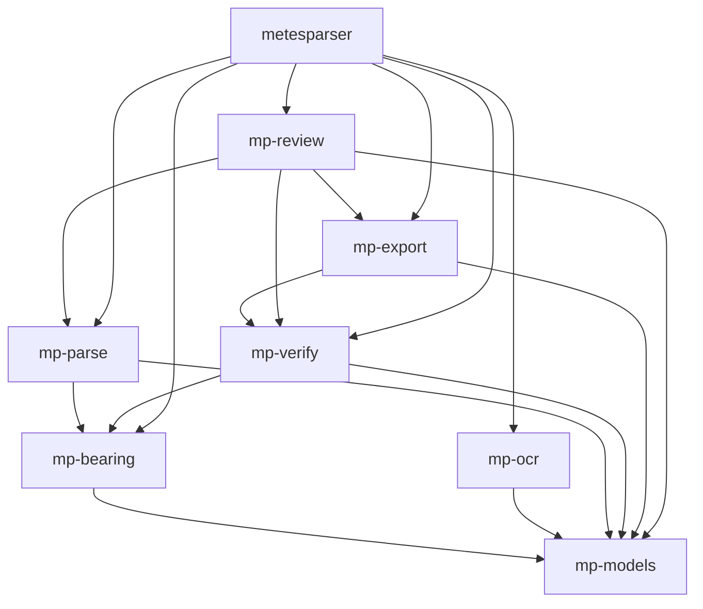
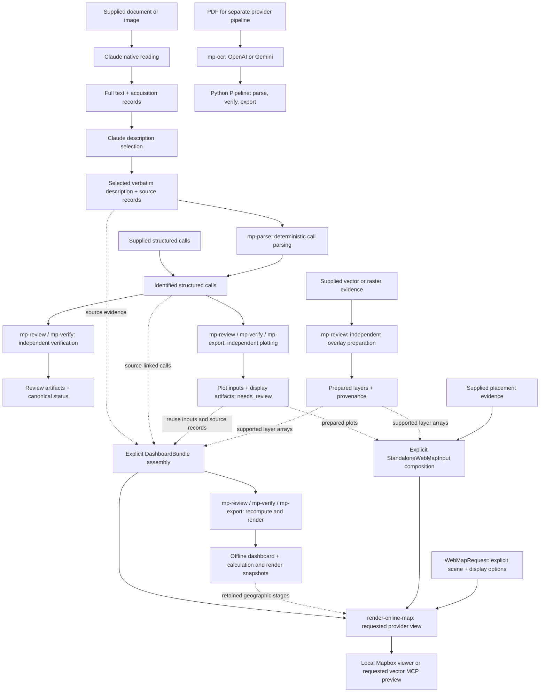

# Architecture

System design and data flow for metesParser.

## Table of Contents

- [System Overview](#system-overview)
- [Core Principles](#core-principles)
- [Composable Package Architecture](#composable-package-architecture)
- [Skill Composition](#skill-composition)
- [Data Flow](#data-flow)
- [Package Details](#package-details)
- [Data Models](#data-models)
- [Verification Pipeline](#verification-pipeline)
- [Error Handling](#error-handling)
- [Performance Considerations](#performance-considerations)
- [Design Decisions](#design-decisions)
- [Concrete Sample Workflow](#concrete-sample-workflow)

## System Overview

metesParser is a deterministic metes & bounds parser that converts legal descriptions from PDFs into structured, verified CSV format.

### Key Characteristics

- **Rule-based parsing** - Numerical call parsing is deterministic; source reading uses `mp-ocr` in the Python pipeline or Claude's native capabilities in the plugin.
- **Deterministic output** - Same input always produces same result
- **Verification-first** - Won't output `_verified.csv` unless all checks pass
- **Never fabricates** - Flags incomplete data rather than guessing
- **Composable** - 8 independently installable packages, each does one thing well

### Technology Stack

- **Python 3.11+** - Modern Python with type hints (`|` unions)
- **Pydantic v2** - Data validation and schema enforcement
- **OpenAI + optional Gemini** - Configurable LLM providers for PDF extraction
- **UV workspace monorepo** - 8 composable packages (no pip/conda/poetry)
- **pytest** - Test framework with ~996 tests (~94% coverage)

## Core Principles

### 1. Never Fabricate Data

```python
# NEVER do this:
if bearing is None:
    bearing = "estimate based on adjacent calls"  # WRONG

# ALWAYS do this:
if bearing is None:
    call.notes = "incomplete bearing - manual review required"  # CORRECT
```

### 2. Verification Before Export

```python
result = ClosureChecker.verify_closure(calls)

if result.is_fully_verified():
    CSVBuilder.export_verified_csv(calls, result, output_path, legal_desc=legal_desc)
else:
    print(f"Cannot export verified CSV: {result.misclosure_ft:.4f} ft misclosure")
```

### 3. Preserve Original Wording

```python
# Keep deed language verbatim in descriptive fields
call = DeedCall(
    bearing_quadrant="S 56 40' W",
    distance_ft=125.0,
    along="the division line between Lots 46 and 47",  # Preserve exact wording
    to="the corner to Lot 50",  # Preserve exact wording
)
```

### 4. Deterministic Processing

```python
# LLM extraction uses temperature=0 for deterministic behavior
from mp_ocr import OpenAIClient, GeminiClient

client = OpenAIClient()
# or
client = GeminiClient()
```

## Composable Package Architecture

The codebase is a **uv workspace monorepo** with 8 independently installable packages: seven `mp-*` packages and the root `metesparser` package:

```
packages/
  mp-models/    -> Pydantic schemas, JSONL envelope, units (zero deps)
  mp-bearing/   -> Pure math: azimuth, curves, deltas (depends: mp-models)
  mp-ocr/       -> LLM boundary: PDF -> text (depends: mp-models)
  mp-parse/     -> Rule-based parsing: text -> calls (depends: mp-models, mp-bearing)
  mp-verify/    -> Geometric verification: 8 checks (depends: mp-models, mp-bearing)
  mp-export/    -> CSV, audit, plot/dashboard rendering (depends: mp-models, mp-verify)
  mp-review/    -> Review/plot/dashboard orchestration + overlay preparation
                  (depends: mp-models, mp-parse, mp-verify, mp-export)
src/metesparser/ -> Orchestrator + backward-compat monolith
```

### Dependency Graph

Arrows show workspace dependencies (external libraries omitted):



### Package-to-Monolith Mapping

The original monolith in `src/metesparser/` is preserved for backward compatibility. Corresponding legacy implementations must stay in sync. `mp-review` has no duplicate monolith implementation; `metesparser.plot` and `metesparser.dashboard` provide compatibility facades to the shared APIs.

| Package | Monolith Module(s) |
|---------|-------------------|
| `mp-models` | `models.py` |
| `mp-bearing` | `bearing_converter.py` |
| `mp-ocr` | `pdf_processor.py`, `llm_clients.py`, `llm_cache.py` |
| `mp-parse` | `call_extractor.py`, `text_parser.py` |
| `mp-verify` | `closure_checker.py` |
| `mp-export` | `csv_builder.py`, `audit_reporter.py` (legacy CSV/audit functionality) |
| `mp-review` | No duplicate implementation; `metesparser.plot` and `metesparser.dashboard` expose compatibility APIs |
| `metesparser` | `pipeline.py`, `cli.py`, `run_registry.py`, `review_packet.py` |

### Pipeline Orchestrator

The `Pipeline` class chains all stages in a single call:

```python
from metesparser import Pipeline

pipe = Pipeline(provider="openai", cache=True, audit=True)
result, audit_ctx = pipe.run(Path("deed.pdf"))
```

Currently wraps the monolith `PDFProcessor` for backward compatibility.

## Skill Composition

The [plugin catalog](../plugins/metesparser/README.md) describes nine skills: six capabilities, two workflows, and the `review-deed` alias for the boundary-review workflow. These skills provide instructions and routing over existing Python packages. Their [shared artifact handoff contract](../plugins/metesparser/references/artifact-handoffs.md) defines accepted inputs, stage stopping points, source identity, invalidation, and status boundaries. For documentation ownership and update checks, see [maintain the skill composition](CLAUDE_PLUGIN.md#maintain-the-skill-composition).



Verification and plotting each accept identified structured calls independently. Plotting does not require a passing verification result and remains advisory (`needs_review`). Overlay preparation is independent of deed geometry and returns layer/provenance artifacts; it does not align a deed. Capability skills stop at their requested deliverable. The boundary-review workflow composes source preparation, selection, and deterministic review as needed; it does not automatically build a plot or dashboard.

Dashboard creation is an explicit composition step: assemble source-linked calls and calculation records in a `DashboardBundle`, reuse plot inputs with their actual source records, and copy supported map-layer arrays into the corresponding bundle fields. The dashboard command does not automatically adapt standalone artifacts. It recomputes geometry under dashboard identities; a later requested placement must bind a supplied transform to the fresh dashboard geometry hash. It never infers alignment. See the [bundle composition mapping](../plugins/metesparser/skills/deed-closure-dashboard/references/dashboard-bundle.md#compose-existing-plot-and-map-artifacts).

A map-only request composes existing `PreparedPlot` objects, map layers, and explicit placements in `StandaloneWebMapInput`, then supplies a separate `WebMapRequest` to `render-map`. It revalidates shared geometry and placement bindings without requiring dashboard assembly. See the [standalone composition recipe](../plugins/metesparser/skills/render-online-map/references/local-viewer.md#compose-existing-artifacts).

Claude's native reading and selection are source-preparation stages outside the Python provider pipeline. The plugin does not substitute `mp-ocr` or an external OCR service for native reading. In the separate Python PDF pipeline below, `mp-ocr` owns OpenAI/Gemini calls. In both paths, parsing, geometry, checks, and rendering use deterministic package code; geometric success does not establish source completeness.

## Data Flow

### Provider-Backed PDF Pipeline

```
PDF -> mp-ocr -> mp-parse -> mp-verify -> mp-export
       LLM       Rules       8 checks    _verified.csv
       extract    extract     closure     .audit.json
                  calls       area        .audit.html
```

### Detailed Flow

```
1. PDF Extraction [mp-ocr]
   |-> Configured LLM provider (OpenAI or Gemini)
   |-> Temperature=0 for determinism
   |-> File-based response caching (CachedLLMClient)
   |-> LLM confidence scoring (7 heuristic signals)
   '-> Returns: Raw legal description text

2. Text Normalization [mp-parse]
   |-> Fix OCR errors (5outh -> South, Ea5t -> East)
   |-> Merge wrapped lines (div-\nision -> division)
   |-> Standardize cardinal directions (South -> S)
   '-> Returns: Normalized text

3. Metadata Extraction [mp-parse]
   |-> POC/POB (Point of Commencement / Point of Beginning)
   |-> PLSS metadata (Section/Township/Range/PM/aliquot)
   |-> Area statement, basis of bearing, surveyor certification
   |-> Prior conveyance, subdivision reference, witness trees
   |-> Coordinate system + FIPS code
   '-> Returns: Populated LegalDescription fields

4. Call Extraction [mp-parse]
   |-> Split calls by numbered markers, THENCE, or semicolons
   |-> Parse bearing (quadrant format)
   |-> Parse distance + unit (feet, chains, varas, etc.)
   |-> Parse curve parameters (R, delta, L)
   |-> Extract along/to descriptive fields
   |-> Classify monuments and monument status
   '-> Returns: List[DeedCall]

5. Bearing Enrichment [mp-parse + mp-bearing]
   |-> Convert quadrant -> azimuth
   |-> Calculate curve properties
   |-> Mark tie-in calls (POC-to-POB)
   '-> Returns: Enriched DeedCall objects

6. Closure Verification [mp-verify]
   |-> Compute traverse (calculate all points)
   |-> Run 8 verification checks
   |-> Calculate area, perimeter, misclosure
   |-> Score per-call quality and overall confidence
   '-> Returns: ClosureResult

7. CSV Export [mp-export]
   |-> If fully verified: export _verified.csv
   |-> Else: export regular .csv with warnings
   '-> If audit_context provided: write .audit.json + .audit.html sidecars

8. Audit Sidecar (optional) [mp-export]
   |-> AuditContext threads through pipeline (created before extraction)
   |-> Captures: LLM confidence, source excerpts, transformations, decisions
   |-> .audit.json: canonical audit data store
   '-> .audit.html: self-contained report with collapsible sections, confidence colors
```

## Package Details

### mp-models

**Purpose**: Data schemas and validation (zero external dependencies beyond Pydantic)

**Key Types**:
- `DeedCall` - Single course with bearing, distance, curve data, and metadata
- `LegalDescription` - Complete deed with calls list + metadata fields
- `ClosureResult` - Verification results with misclosure, area, confidence scoring
- `AuditContext` - Mutable accumulator for audit trail (NOT frozen)
- `CallAudit`, `Transformation`, `Decision` - Per-call audit details
- `RawTextMessage`, `LegalDescriptionMessage`, `ClosureResultMessage` - JSONL envelope types
- `ConversionFactors`, `DistanceUnit` - Unit conversion constants

### mp-bearing

**Purpose**: Pure coordinate math with no I/O

**Key Functions**:
- `parse_quadrant_bearing()` - Parse "S 56 40' W" -> (S, 56.667, W)
- `quadrant_to_azimuth()` - Convert to degrees from North
- `calculate_curve_properties()` - Compute L, chord from R, delta
- `calculate_deltas()` - Compute dx, dy from azimuth, distance
- `parse_packed_dms()` - Parse packed DMS (46.1631 -> 46.2753 degrees)
- `calculate_missing_curve_elements()` - Any 2+ elements -> all 5

**Formulas**:
```
Quadrant to Azimuth:
  N x E -> az = x
  S x E -> az = 180 - x
  S x W -> az = 180 + x
  N x W -> az = 360 - x

Curve: L = R * delta (radians), chord = 2R * sin(delta/2)
Deltas: dx = dist * sin(az), dy = dist * cos(az)
```

### mp-ocr

**Purpose**: LLM boundary - the ONLY package that calls AI

**Key Classes**:
- `PDFProcessor` - Extracts text from deed PDFs via LLM
- `BaseLLMClient` ABC, `OpenAIClient`, `GeminiClient` - Provider implementations
- `CachedLLMClient` - Disk-cached wrapper for LLM responses
- `compute_llm_confidence()` - 7 weighted heuristic signals, 0.0-1.0

### mp-parse

**Purpose**: Rule-based parsing (regex, NOT AI)

**Key Functions**:
- `extract_calls()` - Parse full description -> List[DeedCall]
- `extract_single_call()` - Parse one call
- `enrich_calls_with_azimuths()` - Add missing azimuths
- `mark_tie_in_calls()` - Flag POC-to-POB calls
- `classify_monument()`, `classify_monument_status()` - Monument classification
- Metadata: `extract_plss_metadata()`, `extract_poc_and_pob()`, `extract_area_statement()`, `extract_basis_of_bearing()`, etc.

### mp-verify

**Purpose**: Geometric verification with 8 checks

**Verification Checks**:
1. **Traverse Closure** - Misclosure < 0.01 ft by default
2. **Interior Angles** - Sum = (n-2)*180 degrees
3. **Parallelism** - "continuing" lines match
4. **Curve Math** - L ~ R*delta, chord ~ 2R*sin(delta/2)
5. **Area Check** - Flags if computed area differs >5% from stated
6. **Double Entry** - Optional comparison if second call set supplied
7. **Bearing Reversal** - Adjacent courses ~180 degrees apart
8. **Distance Reasonableness** - Flags <0.5 ft, >10x median, >90% perimeter

**Key Functions**:
- `verify_closure()` - Main verification entry point
- `calculate_confidence_score()` - 0.0-1.0 weighted score
- `score_call_quality()` - Per-call high/medium/low
- `get_closure_summary()` - Human-readable summary

### mp-export

**Purpose**: CSV/audit output and standalone plot/dashboard rendering

**Key Functions**:
- `export_verified_csv()` - Export only if all checks pass
- `calls_to_csv()`, `csv_to_calls()` - CSV I/O
- `generate_html()`, `write_report()` - Audit HTML report
- `plot_html.py`, `plot_svg.py`, `dashboard_html.py` - Display renderers

**CSV Schema** (21 fields):
```csv
course,direction_text,bearing_quadrant,bearing_azimuth_deg_from_north,distance_ft,
curve_dir,radius_ft,delta_deg,arc_length_ft,chord_bearing,chord_length_ft,
along,to,monument_type,monument_status,is_exception,is_meander,is_tie_in,
non_tangent,radial_bearing,notes
```

### mp-review

**Purpose**: Deterministic file/API orchestration and the `metes-review` CLI, without LLM provider calls.

- `api.py`: `review_text()`, `review_file()`, and `verify_file()` coordinate parsing, verification, provenance, and review artifacts.
- `plot.py`: `plot_file()` loads structured input and writes standalone plot artifacts without canonical verification.
- `dashboard.py`: `prepare_dashboard()` and `dashboard_file()` validate bundles, coordinate calculation/cache stages, and write dashboard snapshots.
- `overlays.py`, `raster_registration.py`, `parcel_provider.py`: vector import, supplied raster registration, and explicitly requested parcel retrieval/preparation.

Shared input contracts live in `mp_models` (`DashboardBundle`, `PlotRequest`, relative, scene, and raster models). `mp_verify` owns geometry, topology, relative analysis, scene validation, and dashboard calculations; `mp_export` owns HTML/SVG rendering. `mp-review` coordinates these responsibilities rather than duplicating their engines. Native document transcription and description selection remain Claude skill responsibilities.

## Data Models

### DeedCall

Core data structure representing one deed call:

```python
class DeedCall:
    course: int                                    # Sequential number (1, 2, 3...)
    direction_text: str                            # Raw direction text
    bearing_quadrant: str | None                   # "S 56 40' W"
    bearing_azimuth_deg_from_north: float | None   # 236.667 (degrees from N)
    distance_ft: float                             # Distance in feet (must be > 0)

    # Curve fields (all None for straight lines)
    curve_dir: str | None                          # "left" or "right"
    radius_ft: float | None                        # Curve radius
    delta_deg: float | None                        # Central angle
    non_tangent: bool                             # Non-tangent curve flag
    radial_bearing: str | None                    # Radial bearing (if non_tangent)
    arc_length_ft: float | None                    # Arc length
    chord_bearing: str | None                      # Chord bearing
    chord_length_ft: float | None                  # Chord length

    # Descriptive fields
    along: str | None                              # "along the division line"
    to: str | None                                 # "to an iron pin"
    monument_status: str | None                    # Found/set monument status
    monument_type: str | None                      # Survey marker type
    is_exception: bool                             # EXCEPT/LESS AND EXCEPT marker
    is_meander: bool                               # Water boundary (meander line)
    is_tie_in: bool                                # Tie-in call between POC and POB
    is_indefinite: bool                            # Vague direction without precise bearing
    curve_type: str | None                         # simple, compound, or reverse
    notes: str | None                              # Warnings/flags
```

### ClosureResult

Verification results:

```python
class ClosureResult:
    misclosure_x_ft: float                     # X component of misclosure
    misclosure_y_ft: float                     # Y component
    misclosure_ft: float                       # Total misclosure
    area_sq_ft: float                          # Computed area
    area_acres: float                          # Area in acres
    perimeter_ft: float                        # Total perimeter
    precision_ratio: float | None              # Misclosure / perimeter ratio
    confidence_score: float                    # 0.0-1.0 weighted confidence

    closure_passed: bool                       # Misclosure < tolerance?
    angle_check_passed: bool                   # Angles sum correctly?
    curve_consistency_passed: bool             # Curve math correct?

    warnings: list[str]                        # List of warnings
    points: list[Point]                        # All traverse points

    def is_fully_verified(self) -> bool:
        """Check if all verification checks passed."""
```

## Verification Pipeline

### Traverse Computation

```python
def compute_traverse(calls, start_point=Point(0, 0)):
    """Compute all points from calls."""
    points = [start_point]
    current = start_point

    for call in calls:
        if call.bearing_azimuth_deg_from_north is None:
            continue  # Skip incomplete bearings

        if call.is_curve():
            next_point = compute_curve_endpoint(...)
        else:
            dx, dy = calculate_deltas(call.bearing_azimuth_deg_from_north, call.distance_ft)
            next_point = Point(current.x + dx, current.y + dy)

        points.append(next_point)
        current = next_point

    return points
```

### Area Calculation

Uses the Shoelace formula (Gauss's area formula):

```python
def calculate_area(points):
    area = 0.0
    n = len(points)

    for i in range(n - 1):
        area += points[i].x * points[i+1].y
        area -= points[i+1].x * points[i].y

    return abs(area) / 2.0
```

## Error Handling

### Input Validation

Pydantic enforces constraints at construction:

```python
class DeedCall(BaseModel):
    distance_ft: float = Field(gt=0)  # Must be > 0

# This raises ValidationError:
DeedCall(distance_ft=0.0)
DeedCall(distance_ft=-10.0)
```

### Graceful Degradation

Handle incomplete data without crashing:

```python
if parsed_bearing is None:
    call.bearing_azimuth_deg_from_north = None
    call.notes = "incomplete bearing - manual review required"
    # Continue processing, don't crash
```

### Verification Warnings

Collect warnings rather than failing:

```python
warnings = []
if misclosure > tolerance:
    warnings.append(f"Misclosure {misclosure:.4f} ft exceeds tolerance")
return ClosureResult(..., warnings=warnings)
```

## Performance Considerations

### Fast Operations

- **Text parsing**: Regex-based, very fast (~ms)
- **Bearing conversion**: Pure math, no I/O
- **Traverse computation**: O(n) where n = number of calls
- **Area calculation**: O(n) shoelace formula

### Slow Operations

- **PDF extraction**: LLM API call (~2-5 seconds)
- **Large parcels**: 100+ calls take longer to verify

### Optimization Strategies

1. **LLM response caching** - `CachedLLMClient` avoids re-extracting the same PDF
2. **Batch processing** - Process multiple PDFs in sequence (significantly faster with LLM response cache)
3. **Skip verification** - For quick viewing, don't run all checks

## Design Decisions

### Why Composable Packages?

**Decision**: Keep focused packages independently installable; `mp-review` extends the original seven-package split to eight with deterministic CLI and artifact orchestration.

**Rationale**:
- **Unix philosophy** - Each package does one thing well
- **Independent installation** - Use only what you need (e.g., `pip install mp-bearing` for math only)
- **Clear boundaries** - Only `mp-ocr` calls LLMs; everything else is deterministic
- **Testable in isolation** - Per-package test suites

**Trade-off**: Dual maintenance (packages + monolith for backward compat), but cross-package import tests prevent drift.

### Why Rule-Based Parsing?

**Decision**: Use regex-based parsing instead of AI/ML for call extraction.

**Rationale**:
- **Deterministic** - Same input always produces same output
- **Debuggable** - Easy to see why parsing succeeded/failed
- **Fast** - No model loading or inference time
- **Testable** - Easy to write unit tests

**Trade-off**: More brittle to format variations, but acceptable given standardized legal descriptions.

### Why Pydantic v2?

**Decision**: Use Pydantic for data validation.

**Rationale**:
- **Type safety** - Catch errors at construction time
- **Validation** - Enforce constraints (distance > 0)
- **Serialization** - Easy CSV export/import
- **Documentation** - Self-documenting schemas

### Why UV Instead of Pip?

**Decision**: Mandate UV for dependency management.

**Rationale**:
- **Fast** - Orders of magnitude faster than pip
- **Deterministic** - Lock file ensures reproducibility
- **Workspace support** - Native monorepo support for composable packages
- **Modern** - Built with Rust, actively maintained

### Why Separate Verification Step?

**Decision**: Don't export verified CSV unless all checks pass.

**Rationale**:
- **Quality control** - Prevent bad data from entering GIS
- **Audit trail** - Clear distinction between verified/unverified
- **Professional standards** - Surveying requires verification

## Concrete Sample Workflow

For a concrete, request-by-request walkthrough with actual object snapshots from a real sample PDF, see:

- [pennbrook_sample_workflow_diagrams.md](archive/pennbrook_sample_workflow_diagrams.md)

---

For more information:
- [TESTING.md](TESTING.md) - Test suite architecture
- [API.md](API.md) - Python API reference
- [CONTRIBUTING.md](CONTRIBUTING.md) - Development guidelines

## Optional geographic display architecture

`mp_models.webmap` defines display-only request/artifact contracts, including `StandaloneWebMapInput` for prepared plots and map arrays/placements without a dashboard bundle. The `render-map` adapter revalidates prepared plots through shared geometry logic and rejects stale placements; it makes no source-review or verification claims. `mp_review` derives geographic display geometry and warped raster assets from this validated handoff or a freshly prepared dashboard; `mp_export` renders the optional online companion. The offline renderer remains independently usable. Original calls, calculations, registration, placements, and source-review statuses remain immutable inputs; no GIS math is duplicated in a skill or legacy facade.

The opt-in 2D Mercator companion renders only baseline evidence. It retains identity/projection provenance and explicit partial/unavailable layers, serves declared display files through loopback, and activates Mapbox only after runtime Connect. See the [shared handoff and invalidation contract](../plugins/metesparser/references/artifact-handoffs.md#optional-online-map-handoff) and [runtime guide](../plugins/metesparser/skills/render-online-map/references/local-viewer.md). Projection accuracy, scan residuals, display tolerance, and deed closure remain independent measures.

For a requested in-chat preview, `mp_review.mapbox_mcp` reads intact standalone-map or legacy dashboard stages and `mp_export.mapbox_mcp` serializes their prepared vectors as Mapbox MCP tool arguments. Both online renderers share `mp_verify.webmap` provenance validation. The MCP adapter performs no reprojection, raster warp, or provider call; it retains a local omission report and refuses oversized payloads. The `render-online-map` skill invokes a compatible connected tool only within the requested preview scope. See the [MCP handoff procedure](../plugins/metesparser/skills/render-online-map/references/mapbox-mcp.md) for the separate external data path and host acceptance checks.
