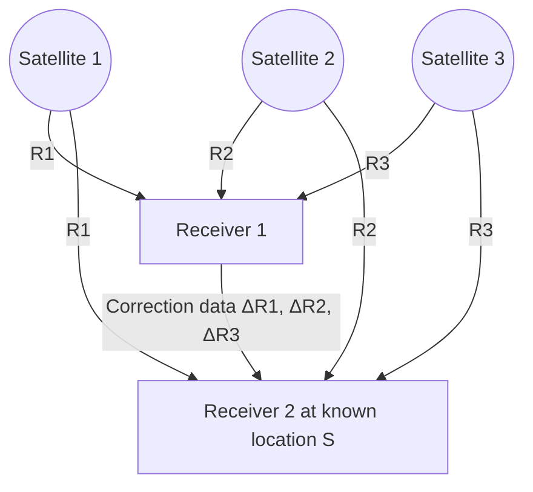

# Learning and Understanding Metes and Bounds Descriptions

### Sneak-peek into a Foreign Language


---


# The Need:

Understand what land is going under conservation easement and what you are monitoring every year.


---


# Objectives:

* basic understanding of distances, bearings, adjoiners and monuments  
* ability to research necessary documents and produce an accurate map using a metes and bounds description  
* recognize differences in boundary orientation due to coordinate systems and association to north  


---


# Scenarios - Real life examples:

* Recording Fail: M&B were recorded with a conservation easement placing the wrong half of the property under easement.
* The mistake was found, and a correction conservation easement was filed.
* If left unnoticed, the land trust would have continued monitoring the wrong half.

----

DEED WITHOUT WARRANTY  
FORMER BERGSTROM AIR FORCE BASE  
TRAVIS COUNTY, TEXAS  
NOTICE OF CONFIDENTIALITY RIGHTS  
IF YOU ARE A NATURAL PERSON, YOU MAY REMOVE OR STRIKE ANY OR ALL OF THE FOLLOWING INFORMATION FROM THIS INSTRUMENT BEFORE IT IS FILED FOR RECORD IN THE PUBLIC RECORDS: YOUR SOCIAL SECURITY NUMBER OR YOUR DRIVER'S LICENSE NUMBER.

I. PARTIES

This Deed made this 10th day of August, 2005, by and between the United States of America, acting by and through the Secretary of the Air Force whose address is Washington, D.C., under and pursuant to the Federal Property and Administrative Services Act of 1949, approved June 30, 1949, (63 Stat. 377), 40 U.S.C. § 101, et seq., as amended, and regulations and orders promulgated thereunder; the Defense Base Closure and Realignment Act of 1990, Pub. L. No. 101-510, as amended, and regulations and orders promulgated thereunder; and a delegation from the Administrator of General Services to the Secretary of Defense, and a subsequent delegation from the Secretary of Defense to the Secretary of the Air Force, party of the first part, as Grantor, and the City of Austin, Texas, a body politic created, operating, and existing under and by virtue of the laws of the State of Texas, party of the second part, as Grantee.

WITNESSETH THAT:

WHEREAS, the Grantor is the owner of the real property described herein, located within the former Bergstrom Air Force Base, situated in Travis County, Texas; and

WHEREAS, the Grantee provided to the United States the money to purchase the real property described herein, under the condition that the United States retain title until such property was abandoned as a permanent Air Base, at which time the Grantee could elect to require the Grantor to convey such land and the improvements thereon to the Grantee; and

WHEREAS, the real property described herein was duly declared surplus and available for disposal pursuant to the powers and authority contained in the provisions of the Defense Base Closure and Realignment Act of 1990, Pub. L. No. 101-510, as amended, and orders and regulations promulgated thereunder; and

WHEREAS, the property is partially subject to a post-closure care plan for SWMU 76 Area 1 which must be maintained by the Air Force and the plan complied with by the Air Force; and  
" visible text 63 Stat. 377


---


# Scenarios - Real life examples:

* Mapping Fail: A map was produced showing a portion of the landowner’s property as not being part of the CE.
* The landowner wanted to sell this portion of her property
* When the M&B were used to re-produce the map, that portion was under conservation easement and was subject to the restrictions of the easement.

Satellite image showing a property with red boundary lines and a yellow arrow pointing to a specific area within the property.


---


# Scenarios - Real life examples:

* Fencing Fail: A new property was proposed to go under CE. The survey showed the land owned by the grantor differed from what was within the fence.
* The Phase 1 was complete on the fenced area and did not evaluate the fill material deposited within the fence.
* The M&B were needed to know where the boundary lines actually were, not where the fence was.

1.22 Acres of 3.00 acre adjoiner within fence, 0.45 Acre of deeded land under others fence, found #4 rebar, City of Schertz 3.00 Acres,


---


# Metes and Bounds:

* Metes and Bounds  
  Description  
  AKA  
* Legal Description  
  AKA  
* Field Notes

<table>
  <tr>
    <td></td>
<td>N 90-00-00 E 100 ft</td>
<td></td>
  </tr>
<tr>
    <td>N 0-0-0 W 100 ft</td>
    <td style="background-color:#b0a0c0;"></td>
<td>S 0-0-0 E 100 ft</td>
  </tr>
<tr>
    <td></td>
<td>S 90-0-0 W 100 ft</td>
<td></td>
  </tr>
</table>


---


# What are Metes:  
## Latin for measurements

Diagram of a square property with bearings and distances labeled at each side:  
- Top side: N 90-00-00 E 100 ft  
- Left side: N 0-0-0 W 100 ft  
- Right side: S 0-0-0 E 100 ft  
- Bottom side: S 90-0-0 W 100 ft  
Four yellow squares mark the corners of the property.

> Description of the bearings and distances of the perimeter of a property


---


# What are Metes:  
## Types of Measurement

**Standard** (or "international") **foot**: .3048 meters

**U.S. survey foot:** 1200/3937 meters

One is defined in relation to the meter by a decimal expression, the other by a fraction.  
(2 parts per million)

**Texas Vara** \(33 \frac{1}{3}\) inches  
3 varas are exactly 100 inches, GLO records

**Gunter's Chain**  
Edmund Gunter (1581–1626), 66 foot long measuring chain of 100 links.


---


# What are Metes: Coordinates

## Degree minute second:
Latitude: 30°12’30"N  
Longitude: 97°39'57"W  

## Decimal Degree:
Latitude: 30.20833°  
Longitude: -97.66583°  

a minute is \( \frac{1}{60}^{th} \) of a degree (12/60 = .2)  
a second is \( \frac{1}{60}^{th} \) of a minute  
a second is \( \frac{1}{3600}^{th} \) of a degree (30/3600 = .00833)  
together = .20833  

<table>
  <thead>
    <tr>
      <th colspan="7">Latitude</th>
    </tr>
  </thead>
  <tbody>
    <tr>
      <td>North Pole</td>
<td>90°</td>
<td>60°</td>
<td>30°</td>
<td>0° (Equator)</td>
<td>-30°</td>
<td>-60°</td>
<td>South Pole (-90°)</td>
    </tr>
  </tbody>
</table>

<table>
  <thead>
    <tr>
      <th colspan="9">Longitude</th>
    </tr>
  </thead>
  <tbody>
    <tr>
      <td>-150°</td>
<td>180°</td>
<td>150°</td>
<td>-120°</td>
<td>120°</td>
<td>-90°</td>
<td>90°</td>
<td>-60°</td>
<td>60°</td>
<td>-30°</td>
<td>30°</td>
<td>0° (Prime Meridian)</td>
    </tr>
  </tbody>
</table>


---


# What are Metes: Quadrants

**Definition:**  
each of four quarters of a circle

<table>
  <thead>
    <tr>
      <th colspan="3"></th>
      <th>N<br>0°</th>
      <th colspan="3"></th>
    </tr>
  </thead>
  <tbody>
    <tr>
      <td>60°</td>
<td>30°</td>
<td>NW<br>Quadrant</td>
<td></td>
<td>NE<br>Quadrant</td>
<td>30°</td>
<td>60°</td>
    </tr>
<tr>
      <td>90° W</td>
      <td colspan="5"></td>
<td>90° E</td>
    </tr>
<tr>
      <td>60°</td>
<td>30°</td>
<td>SW<br>Quadrant</td>
<td></td>
<td>SE<br>Quadrant</td>
<td>30°</td>
<td>60°</td>
    </tr>
  </tbody>
  <tfoot>
    <tr>
      <td colspan="3"></td>
<td>S<br>0°</td>
      <td colspan="3"></td>
    </tr>
  </tfoot>
</table>


---


# What are Metes: Quadrants

A circle divided into four quadrants by a vertical and horizontal line. The top is labeled N, bottom S, left W, and right E. The top right quadrant is labeled NORTH EAST with an arrow curving clockwise. The top left quadrant is labeled NORTH WEST with an arrow curving counterclockwise. The bottom right quadrant is labeled SOUTH EAST with an arrow curving clockwise. The bottom left quadrant is labeled SOUTH WEST with an arrow curving counterclockwise.

* Bearings are measured as the angle from due north and due south.
* They are stated as which quadrant they are in, as identified by the first and last letter of each bearing.


---


# What are Metes:  
## Quadrants

* A **bearing** is an angle less than 90° within a quadrant defined by the cardinal directions.  
* An **azimuth** is an angle between 0° and 360° measured clockwise from North.

<table>
  <thead>
    <tr>
      <th colspan="5">Quadrant Notation</th>
      <th></th>
      <th colspan="5">Azimuth Notation</th>
    </tr>
  </thead>
  <tbody>
    <tr>
      <td>309°</td>
<td>0°</td>
<td>30°</td>
<td></td>
<td>330°</td>
<td></td>
<td>0°</td>
<td>30°</td>
<td>360°</td>
<td></td>
<td>30°</td>
    </tr>
<tr>
      <td colspan="5" style="text-align:center;">N</td>
<td></td>
      <td colspan="5" style="text-align:center;">N</td>
    </tr>
<tr>
      <td>60°</td>
<td></td>
<td></td>
<td>60°</td>
<td></td>
<td></td>
<td>60°</td>
<td></td>
<td></td>
<td>60°</td>
<td></td>
    </tr>
<tr>
      <td>90°</td>
<td>W</td>
      <td colspan="2" style="text-align:center;">Quadrant Notation</td>
<td>E</td>
<td>90°</td>
<td>270°</td>
<td>W</td>
      <td colspan="2" style="text-align:center;">Azimuth Notation</td>
<td>E</td>
    </tr>
<tr>
      <td>60°</td>
<td></td>
<td></td>
<td>S</td>
<td></td>
<td>60°</td>
<td>240°</td>
<td></td>
<td>S</td>
<td></td>
<td>120°</td>
    </tr>
<tr>
      <td>30°</td>
<td>0°</td>
<td></td>
<td>30°</td>
<td></td>
<td>210°</td>
<td>180°</td>
<td>150°</td>
<td></td>
<td></td>
<td></td>
    </tr>
  </tbody>
</table>


---


# What are Metes: Bearings

"135°" and "South 45° East" are the same direction expressed as a bearing and as an azimuth.

"North 45° East" and "South 45° West" are the same angle of a line.

<table>
<thead>
<tr>
<th colspan="4">Azimuths</th>
<th colspan="4">Bearings</th>
<th colspan="4">Bearings</th>
</tr>
</thead>
<tbody>
<tr>
<td>315°</td>
<td>0°</td>
<td>45°</td>
<td></td>
<td>N 45° W</td>
<td></td>
<td>N</td>
<td>N 45° E</td>
<td></td>
<td>N 45° W</td>
<td></td>
<td>N 45° E</td>
</tr>
<tr>
<td></td>
<td></td>
<td></td>
<td></td>
<td>W</td>
<td></td>
<td></td>
<td>E</td>
<td>W</td>
<td></td>
<td></td>
<td>E</td>
</tr>
<tr>
<td>270°</td>
<td></td>
<td>90°</td>
<td></td>
<td></td>
<td></td>
<td></td>
<td></td>
<td></td>
<td></td>
<td></td>
<td></td>
</tr>
<tr>
<td>225°</td>
<td>180°</td>
<td>135°</td>
<td></td>
<td>S 45° W</td>
<td></td>
<td>S</td>
<td>45° E</td>
<td>S 45° W</td>
<td></td>
<td></td>
<td>S 45° E</td>
</tr>
</tbody>
</table>


---


# What are Metes:  
## EXAMPLE

What are Metes: EXAMPLE


---


Diagram of a parallelogram with four arrows pointing upward from each vertex. The left vertical arrow is labeled "N".


---


```
                 45°
                 ↑
          180.00'       280.00'
     50°  N ↑                      ↑ 70°
          203.70'       220.00'
        39°20'42" ↑
```


---


```
N50°00'00"E 180.00'
S45°00'00"E 280.00'
S70°00'00"W 220.00'
N39°20'42"W 203.70'
```


---


# What are Bounds:

* Simple past tense and past participle of **bind**.
* Description by calls for adjoinders.
  - Adjoining - next to or joined with.

<table>
  <tr>
    <td>Development LLC</td>
<td>65.2 acres</td>
<td>Vol. 5 Page 68</td>
  </tr>
<tr>
    <td>Green Leaf Land Trust</td>
<td>1200.5 acres</td>
<td>Vol. 75 Page 342</td>
  </tr>
<tr>
    <td>John Smith</td>
<td>1.25 acres</td>
<td>Vol. 5 Page 273</td>
  </tr>
</table>

> Conservation Drive  
> 40' right-of-way  
> 1.06 acres


---


# Monuments:  
physical evidence of the metes and bounds

<table>
  <tr>
    <td colspan="2">Development LLC<br>65.2 acres<br>Vol. 5 Page 68</td>
<td>found #4 rebar</td>
  </tr>
<tr>
    <td colspan="2" rowspan="2">found 2" steel post<br>Point of Beginning</td>
<td>Green Leaf Land Trust<br>1200.5 acres<br>Vol. 75 Page 342</td>
  </tr>
<tr>
    <td>set #4 rebar</td>
  </tr>
<tr>
    <td>A 1.06 acres</td>
<td>found 6" cedar corner fence post</td>
<td>John Smith<br>1.25 acres<br>Vol. 5 Page 273</td>
  </tr>
</table>


---


# Metes and Bounds Description:

Metes and Bounds Diagram

*Development LLC*  
65.2 acres  
Vol. 5 Page 68  

*Green Leaf Land Trust*  
1200.5 acres  
Vol. 75 Page 342  

*John Smith*  
1.25 acres  
Vol. 5 Page 273  

----

- **Point of Beginning**  
  - found 2" steel post  

- **Boundaries and Measurements:**  
  - N50°00'00"E 180.00' (found #4 rebar)  
  - S45°00'00"E 280.00' (set #4 rebar)  
  - S70°00'00"W 220.00' (found #5 rebar bears S32°34'36"E 237.6')  
  - N39°20'42"W 203.70' (found 6" cedar corner fence post)  
  - 40' right-of-way along Conservation Drive  

- **Area:**  
  - 1.06 acres  

----

## Metes and Bounds Description Components:

* Title  
* General Description  
* Particular Description  
* Exceptions/Reservations  
* Certification  


---


# **Title**  
Metes and Bounds Description of

## **General Description:**  
1.06 acres as described as 1.05 acres in Volume 92 on Page 344 of the Official Public Records of Medina County, Texas, being more particularly described as:

----

found 2 ,  ,  ,   cedar corner fence post E 180.00', S45°00'00 W 220.00', N39°20'42


---


# Particular Description:

BEGINNING at a found 2” steel post, the west corner of this tract, the south corner of a 65.2 acre tract, and on the east right-of-way line of Conservation Drive;

----

## Survey Map Details

- **Point of Beginning:** found 2” steel post
- **Acreage:** 1.06 acres
- **Boundaries:**

| Direction & Distance          | Boundary Description                  |
|------------------------------|-------------------------------------|
| N50°00'00"E 180.00'          | Adjacent to Development LLC (65.2 acres, Vol. 5 Page 68) |
| S45°00'00"E 280.00'          | Adjacent to Green Leaf Land Trust (1200.5 acres, Vol. 75 Page 342) |
| S70°00'00"W 220.00'          | Adjacent to John Smith (1.25 acres, Vol. 5 Page 273) |
| N39°20'42"W 203.70'          | Along Conservation Drive (40' right-of-way) |

- **Markers:**
  - Found 2” steel post (Point of Beginning)
  - Found #4 rebar
  - Set #4 rebar
  - Found #5 rebar bears S32°34'36"E 237.6'
  - Found 6” cedar corner fence post

----

### Adjacent Properties

| Owner/Entity          | Acreage     | Reference          |
|----------------------|-------------|--------------------|
| Development LLC       | 65.2 acres  | Vol. 5 Page 68     |
| Green Leaf Land Trust | 1200.5 acres| Vol. 75 Page 342   |
| John Smith           | 1.25 acres  | Vol. 5 Page 273    |

----

### Road

- Conservation Drive (40' right-of-way)


---


Development LLC  
65.2 acres  
Vol. 5 Page 68  

found 2" steel post  
Point of Beginning  

N50°00'00"E 180.00'  

found #4 rebar  

S45°00'00"E 280.00'  

set #4 rebar  
found #5 rebar bears S32°34'36"E 237.6'  

S70°00'00"W 220.00'  

found 6" cedar corner fence post  

N39°20'42"W 203.70'  

Conservation Drive  
40' right-of-way  

1.06 acres  

John Smith  
1.25 acres  
Vol. 5 Page 273  

Green Leaf Land Trust  
1200.5 acres  
Vol. 75 Page 342  

...cont. Particular Description:  

THENCE N50°00'00"E 180.00’ with the south line of the 65.2 acre tract to a found #4 rebar, the north corner of this tract, and the west corner of a 1200.5 acre tract described in Volume 75 on Page 342, on the southeast line of the 65.2 acre tract;


---


## ...cont. Particular Description:

 steel post Point of Beginning 1.06 acres found 6 E 237.6' 

THENCE S45°00'00"E 280.00’ with the west line of the 1200.5 acre tract to a set #4 rebar, the east corner of this tract, and the north corner of a 1.25 acre tract described in Vol. 5 on Page 273 of the Official Public Records, on the west line of the 1200.5 acre tract, and from which a found #5 rebar, the southeast corner of the 1.25 acre tract, bears S32°34'36"E 237.6’;


---


Development LLC  
65.2 acres  
Vol. 5 Page 68  

Land plot diagram showing boundaries and neighbors with measurements and markers  

...cont. Particular Description:  

THENCE S70°00'00"W  
220.00’  
with the north line of the 1.25 acre tract to a found 6” cedar corner fence post, the south corner of this tract, and the west corner of the 1.25 acre tract, on the east right-of-way line of Conservation Drive;  


---


## ...cont. **Particular Description:**

THENCE N39°20'42"W 203.70’  
with the east right-of-way line of Conservation Drive to the POINT OF BEGINNING, containing 1.06 acres of land.

### **Exceptions and Reservations**

### **Certification**

<table>
  <tr>
    <td colspan="3" style="text-align:center;">Development LLC</td>
  </tr>
<tr>
    <td colspan="3" style="text-align:center;">65.2 acres</td>
  </tr>
<tr>
    <td colspan="3" style="text-align:center;">Vol. 5 Page 68</td>
  </tr>
<tr>
    <td colspan="3" style="text-align:center;">found #4 rebar</td>
  </tr>
<tr>
    <td colspan="3" style="text-align:center;">Green Leaf Land Trust</td>
  </tr>
<tr>
    <td colspan="3" style="text-align:center;">1200.5 acres</td>
  </tr>
<tr>
    <td colspan="3" style="text-align:center;">Vol. 75 Page 342</td>
  </tr>
<tr>
    <td colspan="3" style="text-align:center;">found 2" steel post</td>
  </tr>
<tr>
    <td colspan="3" style="text-align:center;">Point of Beginning</td>
  </tr>
<tr>
    <td colspan="3" style="text-align:center;">1.06 acres</td>
  </tr>
<tr>
    <td colspan="3" style="text-align:center;">found 6" cedar corner fence post</td>
  </tr>
<tr>
    <td colspan="3" style="text-align:center;">John Smith</td>
  </tr>
<tr>
    <td colspan="3" style="text-align:center;">1.25 acres</td>
  </tr>
<tr>
    <td colspan="3" style="text-align:center;">Vol. 5 Page 273</td>
  </tr>
</table>


---


DISCLAIMER

# DISCLAIMER

## Solution:  
### Equations Used

* L = length of curve (arc)  
* Δ or I = central angle  
* LC = long chord  
* D° = Degree of Curvature  
* R = radius  
* T = tangent length  
* PI = intersection of tangents  
* E = external distance  
* M = middle ordinate distance  

----

### Equations:

$$ L = 2 \pi R \left(\frac{I}{360^\circ}\right) $$  
$$ T = R \tan\left(\frac{I}{2}\right) $$  
$$ PC \, Station = PI - T $$  
$$ LC = 2R \sin\left(\frac{I}{2}\right) $$  

$$ D^\circ = 100 \left(\frac{I}{L}\right) \quad \text{(note: I in degrees)} $$  
$$ PT \, Station = PC + L $$  
$$ M = R \left(1 - \cos\left(\frac{I}{2}\right)\right) $$  

$$ E = R \left(\frac{1}{\cos\left(\frac{I}{2}\right)} - 1\right) $$  

----

### Diagram Description:

- The diagram shows a curve with points labeled PC, PI, PT, POT, and POC.
- The curve length is marked as "LENGTH OF CURVE".
- The triangle formed by points PC, PT, and PI shows radius R, long chord LC, tangent length T, and central angle I (or Δ).
- The middle ordinate distance M and external distance E are also indicated.
- Back tangent and forward tangent lines are shown.
- The central angle I is split into two halves in the diagram.
- The degree of curvature D° is indicated.

----

## Curves

Enter chord and chord bearing to close the perimeter and adjust to fit later.


---


# Make a Map

Get the data:  
Google Earth or GIS w/ basemap  
County  
Approximate boundaries – create a KMZ

Map showing Austin area with highways and TLTC Conference location marked "TLTC Conference Travis"


---


# Make a Map

Get the data:  
County Appraisal District

Map showing parcel boundaries with labels such as 903021, 855896, 903610, 724575, and street names including Freight Ln, Rent Car Rd, Spirit of Texas Dr, Presidential Blvd, Employee Ave, Service Rd, Bastrop Hwy, and TX 71 E. The map highlights a large outlined area in light blue.


---


# Make a Map

Get the data:  
County Appraisal District

Map with Property Information popup showing:  
Property Information (724575)  
Owner Name: CITY OF AUSTIN  
Doing Business As: ABIA  
Property Identification Number: 724575  
Geo Identification Number: 0315210923  
Legal Description: ABS 24 DELVALLE S ACR 124.9749  
State Code: F1  
Address:  
Taxing Jurisdictions: 0A, 2J, 03, 06, 02, 68  
Appraised Value: N/A  
Neighborhood: FORMERLY GEXMP  
Abstract Code: A0024  
Buttons: Property Detail | Zoom In  
Map streets visible: Freight Ln, Rent Car Rd, Spirit of Texas Dr, Presidential Blvd, Employee Ave, Service Rd  
Parcel numbers visible: 855896, 903610, 724575, 716144  
 724575


---


# Owner

| Name          | CITY OF AUSTIN       | Owner ID:   | 571690          |
|---------------|----------------------|-------------|-----------------|
| Mailing Address: | PO BOX 1088         | % Ownership:| 100.0000000000% |
|               | AUSTIN, TX 78767-1088| Exemptions: | EX-XV           |

## Values

## Taxing Jurisdiction

## Improvement / Building

## Land

## Roll Value History

## Deed History - (Last 3 Deed Transactions)

<table>
  <thead>
    <tr>
      <th>#</th>
      <th>Deed Date</th>
      <th>Type</th>
      <th>Description</th>
      <th>Grantor</th>
      <th>Grantee</th>
      <th>Volume</th>
      <th>Page</th>
      <th>Deed Number</th>
    </tr>
  </thead>
  <tbody>
    <tr>
      <td>1</td>
<td>8/10/2005</td>
<td>DW</td>
<td>DEED WITHOUT WARRANTY</td>
<td>U S GOVERNMENT</td>
<td>CITY OF AUSTIN</td>
<td></td>
<td></td>
<td>2005160431TR</td>
    </tr>
  </tbody>
</table>

Questions Please Call (512) 834-9317  
This site requires cookies to be enabled in your browser settings.


---


# Travis County  
## County Clerk Web Search

Welcome Visitor.

----

| Welcome | Marriage Records | **Official Public Records** | FAQ |

----

## OPR Document Access

Permanent Index From 01/01/1988 to 02/01/2019  
Temporary Index from 02/02/2019 to 02/09/2019  
Images from 04/05/1999  

`[ Search ]`  `[ Clear Form ]`

----

### General

<table>
  <tr>
    <td><b>Grantor:</b></td>
<td><input type="text" placeholder=""/></td>
  </tr>
<tr>
    <td><b>Grantee:</b></td>
<td><input type="text" placeholder="Lastname Firstname"/></td>
  </tr>
<tr>
    <td><b>Date Filed From:</b></td>
<td><input type="text" placeholder="mm/dd/yyyy"/></td>
<td><b>To:</b></td>
<td><input type="text" placeholder="mm/dd/yyyy"/></td>
  </tr>
<tr>
    <td><b>Instrument # From:</b></td>
<td><input type="text" value="2005160431TR"/></td>
<td><b>To:</b></td>
<td><input type="text" placeholder=""/></td>
  </tr>
<tr>
    <td><b>Book:</b></td>
<td><input type="text" placeholder=""/></td>
<td><b>Page:</b></td>
<td><input type="text" placeholder=""/></td>
  </tr>
<tr>
    <td><b>Document Type:</b></td>
    <td colspan="3">
      [ ] ABANDONMENT OF ASSUMED NAMES<br/>
      [ ] ABSTRACT OF JUDGMENT<br/>
      [ ] AFFIDAVIT<br/>
      [ ] AFFIDAVIT OF CLAIM<br/>
      [ ] AFFIDAVIT OF HEIRSHIP
    </td>
  </tr>
</table>


---


IowRwemuS DEED                                        2005160431                    MACIAS & ASSOCIATES, Inc.
23 PGS                                               LAND SURVEYORS

# DEED WITHOUT WARRANTY

## FORMER BERGSTROM AIR FORCE BASE  
### TRAVIS COUNTY, TEXAS

### NOTICE OF CONFIDENTIALITY RIGHTS  
IF YOU ARE A NATURAL PERSON, YOU MAY REMOVE OR STRIKE ANY OR ALL OF THE FOLLOWING INFORMATION FROM THIS INSTRUMENT BEFORE IT IS FILED FOR RECORD IN THE PUBLIC RECORDS: YOUR SOCIAL SECURITY NUMBER OR YOUR DRIVER'S LICENSE NUMBER.

## I. PARTIES

This Deed made this `10th` day of `August`, 2005, by and between the United States of America, acting by and through the Secretary of the Air Force whose address is Washington, D.C., under and pursuant to the Federal Property and Administrative Services Act of 1949, approved June 30, 1949, (63 Stat. 377), 40 U.S.C. § 101, et seq., as amended, and regulations and orders promulgated thereunder; the Defense Base Closure and Realignment Act of 1990, Pub. L. No. 101-510, as amended, and regulations and orders promulgated thereunder; and a delegation from the Administrator of General Services to the Secretary of Defense, and a subsequent delegation from the Secretary of Defense to the Secretary of the Air Force, party of the first part, as Grantor, and the City of Austin, Texas, a body politic created, operating, and existing under and by virtue of the laws of the State of Texas, party of the second part, as Grantee.

### WITNESSETH THAT:

**WHEREAS**, the Grantor is the owner of the real property described herein, located within the former Bergstrom Air Force Base, situated in Travis County, Texas; and

**WHEREAS**, the Grantee provided to the United States the money to purchase the real property described herein, under the condition that the United States retain title until such property was abandoned as a permanent Air Base, at which time the Grantee could elect to require the Grantor to convey such land and the improvements thereon to the Grantee; and

**WHEREAS**, the real property described herein was duly declared surplus and available for disposal pursuant to the powers and authority contained in the provisions of the Defense Base Closure and Realignment Act of 1990, Pub. L. No. 101-510, as amended, and orders and regulations promulgated thereunder; and

**WHEREAS**, the property is partially subject to a post-closure care plan for SWMU 76 Area 1 which must be maintained by the Air Force and the plan complied with by the Air Force; and

----

## MACIAS & ASSOCIATES, Inc.  
LAND SURVEYORS

Exhibit "A"  
(PARCEL F)  

United States of America  
to  
City of Austin

### LEGAL DESCRIPTION

OF A 157.876 ACRE PARCEL OF LAND OUT OF THE SANTIAGO DEL VALLE TEN LEAGUE GRANT, ABSTRACT NO. 24, TRAVIS COUNTY, TEXAS; ALSO BEING OUT OF:

1.) TRACT NO. A-1, A 168.96 ACRE PARCEL CONVEYED TO THE UNITED STATES OF AMERICA BY INSTRUMENT OF RECORD IN VOLUME 709, PAGE 181, DEED RECORDS OF SAID TRAVIS COUNTY;  
2.) TRACT NO. A-2, COMPRISED OF TWO PARCELS 87.84 ACRES AND 295.59 ACRES CONVEYED TO THE UNITED STATES OF AMERICA BY INSTRUMENT OF RECORD IN VOLUME 708, PAGE 115, DEED RECORDS OF SAID TRAVIS COUNTY;  
3.) TRACT NO. A-3, A 103.62 ACRE PARCEL CONVEYED TO THE UNITED STATES OF AMERICA BY INSTRUMENT OF RECORD IN VOLUME 709, PAGE 390, DEED RECORDS OF SAID TRAVIS COUNTY;  
4.) TRACT NO. A-19, A 139.85 ACRE PARCEL CONVEYED TO THE UNITED STATES OF AMERICA BY INSTRUMENT OF RECORD IN VOLUME 709, PAGE 67, DEED RECORDS OF SAID TRAVIS COUNTY; AND A PORTION OF THE ABANDONED OLD BASTROP ROAD;

SAID 157.876 ACRE PARCEL AS SHOWN ON THE ACCOMPANYING SKETCH, IS MORE PARTICULARLY DESCRIBED BY METES AND BOUNDS AS FOLLOWS:

**BEGINNING** at the westernmost corner of this parcel, being a point occupied by monitoring well MW8-15; also being SOUTH 2191.23 feet and EAST 2734.78 feet from a brass disk in concrete found in the centerline at the north end of the west runway 17R/35L;


---


(157.876 Acres)

**THENCE**, N 46° 16' 31" E, 1622.32 feet to a point occupied by monitoring well SM62MW at an angle point;

**THENCE**, N 40° 48' 20" E, 876.24 feet to a point occupied by monitoring well SM53MW at an angle point;

**THENCE**, N 59° 39' 54" E, 1093.78 feet to a point on the southwesterly right-of-way line of State Highway No. 71;

**THENCE**, the following six (6) courses with said right-of-way line:

1.) S 47° 23' 55" E, 234.00 feet to a TxDOT Type I concrete monument found at an angle point;

2.) S 58° 11' 43" E, 600.18 feet to a TxDOT Type I concrete monument found at an angle point;

3.) S 35° 21' 42" E, 206.16 feet to a ½" iron rod set at an angle point;

4.) S 58° 11' 43" E, 210.00 feet to a ½" iron rod set at an angle point;

5.) N 76° 48' 17" E, 127.28 feet to a ½" iron rod set at an angle point;

6.) S 58° 17' 05" E, 442.41 feet to a point at the easternmost corner of this parcel, from said point, a TxDOT Type I concrete monument found bears, S 58° 17' 05" E, 167.32 feet;

**THENCE**, S 39° 29' 51" W, 2538.95 feet to a point occupied by monitoring well SM08MW at an angle point;

**THENCE**, S 73° 33' 09" W, 823.14 feet to a point occupied by monitoring well SM14MW at an angle point;

**THENCE**, N 70° 30' 20" W, 1557.44 feet to a point occupied by monitoring well SM80MW at an angle point;

**THENCE**, N 45° 25' 30" W, 416.78 feet to the **POINT OF BEGINNING**, containing 157.876 acres of land.

----

### BEARING BASIS NOTE

The bearings described herein are based on the Bergstrom Airport Coordinate System (BACS). The reference for this project is two brass disks in concrete found on the centerline of the west runway at the Austin – Bergstrom International Airport at an assumed bearing of NORTH.

----

### THE STATE OF TEXAS  §  
### COUNTY OF TRAVIS  §  
### KNOW ALL MEN BY THESE PRESENTS:

That I, Henry A. Dufeau, a Registered Professional Land Surveyor, do hereby certify that the above description is true and correct to the best of my knowledge and belief and that the property described herein was determined by a survey made on the ground under my direction and supervision.

WITNESS MY HAND AND SEAL at Austin, Travis County, Texas this the 15th day of March, 2009.

----

MACIAS & ASSOCIATES, INC.  
5410 South 1st Street  
Austin, Texas 78745-3040  

Henry A. Dufeau  
Registered Professional Land Surveyor  
No. 1707-State of Texas

----

### REFERENCES

TCAD # 0315310601  
AUSTIN GRID N-16


---


# Data Entry

* Quadrants are numbered 1-4  
* **Data entry starts with quadrant #**  
* Followed by the degrees, minutes, seconds, and distance  

**EXAMPLE**  
N46°16’31"E  1622.32’  
Quadrant = 1  
Bearing = 46.1631  
Distance = 1622.32  

<table>
  <thead>
    <tr>
      <th colspan="2">Quadrants</th>
    </tr>
  </thead>
  <tbody>
    <tr>
      <td style="text-align:center;">IV<br>NW Quadrant</td>
      <td style="text-align:center;">I<br>NE Quadrant</td>
    </tr>
<tr>
      <td style="text-align:center;">III<br>SW Quadrant</td>
      <td style="text-align:center;">II<br>SE Quadrant</td>
    </tr>
  </tbody>
</table>


---


EXAMPLE  
N46°16’31"E  1622.32’

Quadrant = 1  
Bearing = 46.1631  
Distance = 1622.32  

EXAMPLE  
N45°25’30“W  416.70’

Quadrant = 4  
Bearing = 45.2530  
Distance = 416.70  

S47°23’55”E  234.00’  
S58°11’43”E  600.18’  
S35°21’42”E  206.16’  
S58°11’43”E  210.00’  
N76°48’17”E  127.28’  
S58°17’05”E  442.41’  
S39°29’51”W  2538.95’  
S73°33’09”W  823.14’  
N70°30’20”W  1557.44’  
N40°48’20”E  876.24’  
N59°39’54”E  1093.78’  


---


# Data Entry

* Use coordinate of a known point to associate boundary

* Description called for end of runway and alignment of runway for “north”

> **BEARING BASIS NOTE**  
> The bearings described herein are based on the Bergstrom Airport Coordinate System (BACS). The reference for this project is two brass disks in concrete found on the centerline of the west runway at the Austin – Bergstrom International Airport at an assumed bearing of NORTH.

runway TLTC Conference


---


Aerial view of an airport with a marked boundary area in orange. The image includes runways, taxiways, buildings, parking lots, and surrounding land. A scale bar is shown at the bottom left, along with a north arrow pointing upwards.

does not represent a  
boundary survey  
boundary drafted with  
record description  
Texas Coordinate System,  
South Central Zone,  
North American Datum, 1983  

| 0 | 375 | 750 | 1,500 Feet |

**157.87 acres**  
City of Austin  
dba Austin Airport Hilton  

**MEDINA VALLEY SURVEYS**  
Surveying Texas Since 1985  
709 Washington Street, Castroville, TX 78009  
MedinaValleySurveys.com 830.576.1634  
TBPLS FIRM # 100002-00  

User Community Sources: Esri, Esri, Earthstar Geographics, CNES/Airbus DS, USDA, USGS, AeroGRID, IGN, and the GIS User Community, Esri, HERE, Garmin, USGS, Intermap, INCREMENT P, NRCan, Esri Japan, METI, Esri China (Hong Kong), Esri (Thailand), NGCC, © OpenStreetMap contributors, and the GIS User Community


---


157.87 acres City of Austin dba Austin Airport Hilton

Sources: Esri, HERE, Garmin, USGS, Intermap, INCREMENT P, NRCan, Esri Japan, MÉT.J, Esri China (Hong Kong), Esri Korea, Esri (Thailand), NGCC, OpenStreetMap contributors, and the GIS User Community

does not represent a  
boundary survey  
boundary drafted with  
record description  
Texas Coordinate System,  
South Central Zone,  
North American Datum, 1983

157.87 acres  
City of Austin  
dba Austin Airport Hilton

MEDINA VALLEY SURVEYS  
Surveying Texas Since 1985  
709 Washington Street, Castroville, TX 78009  
MedinaValleySurveys.com 830.576.1634  
TBPLS FIRM # 100002-00


---


# Draft a boundary:

* ArcGIS - Arcmap  
* Toolbar – COGO - Traverse  
* Requires Standard or Advanced license (Disabled with a Basic License)  

Traverse Create new line or polygon features by specifying courses in a traverse.  
Requires a Standard or an Advanced license and is disabled with a Basic license.  
Press F1 for more help.  


---


# Draft a boundary:

* ArcGISPro  
* After developing a feature class  
* On the Edit tab, in the Features group, click Create  
* The Create Features pane appears.  

<table>
  <thead>
    <tr>
      <th colspan="2">Direction and Distance <button>X</button></th>
    </tr>
  </thead>
  <tbody>
    <tr>
      <td>Horizontal:</td>
<td>N12-05-13E QB</td>
    </tr>
<tr>
      <td>Pitch:</td>
<td>-4.87 dd</td>
    </tr>
<tr>
      <td>Distance:</td>
<td>125.24 ft</td>
    </tr>
  </tbody>
</table>

* Click a polyline or polygon feature template.  
* Click the Line or Polygon tool.  
* Create the first vertex using one of the following methods:  
  - Click the map.  
  - Right-click and click Absolute X,Y,Z, or press F6, type the values on the dialog box, and press Enter.  
* Press G, or right-click and click Direction/Distance.  
* The Direction and Distance dialog box appears.  


---


# Draft a boundary:

* Plat Plotter: http://platplotter.appspot.com
* Need start coordinate
* Enter with DMS
* Export boundary as KML

<table>
<thead>
<tr>
<th colspan="7">Survey data:</th>
<th colspan="6">Survey error 4050.7 at 285.3 degrees over 6,548 feet. (61.86%)</th>
</tr>
<tr>
<th>Leg</th>
<th>N,S</th>
<th>D</th>
<th>M</th>
<th>S</th>
<th>E,W</th>
<th>Feet</th>
<th>Point</th>
<th>Survey call</th>
<th>Bearing</th>
<th>Latitude</th>
<th>Longitude</th>
</tr>
</thead>
<tbody>
<tr>
<td>1</td>
<td>S</td>
<td>0</td>
<td>0</td>
<td>0</td>
<td>E</td>
<td>2191.23</td>
<td>1</td>
<td>S O E 2191.2</td>
<td>180</td>
<td>30.2136</td>
<td>-97.6794</td>
</tr>
<tr>
<td>2</td>
<td>S</td>
<td>90</td>
<td>0</td>
<td>0</td>
<td>E</td>
<td>2734.78</td>
<td>2</td>
<td>S 90 E 2734.8</td>
<td>90</td>
<td>30.2075</td>
<td>-97.6794</td>
</tr>
<tr>
<td>3</td>
<td>N</td>
<td>46</td>
<td>16</td>
<td>3</td>
<td>E</td>
<td>1622.32</td>
<td>3</td>
<td>N 46 16 3 E 1622.3</td>
<td>46</td>
<td>30.2075</td>
<td>-97.6706</td>
</tr>
</tbody>
</table>

**Last call:**  
N 74 40 57 W 4050.7 feet.

<table>
<tbody>
<tr>
<td> end </td>
<td> Survey error 4051 feet </td>
<td> 285.3 </td>
<td> 30.2106 </td>
<td> -97.6669 </td>
</tr>
</tbody>
</table>

Plat Plotter screenshot showing map with boundary polygon and survey data table( "Plat Plotter 1.45.8, Wed, 20 Feb 22:52. Welcome, Guest. Sign in or register. Survey Start: 30.213586 -97.679375 Declination: declination Edit Survey Add Curve Recalculate Plat start point is (30.214,-97.679), with 3 legs, 133.5 acres. Closes to 4050.7 feet. Map with polygon boundary and survey data table.")


---


# Things to consider


---


# North

* **astronomical north:** is marked in the skies by the north celestial pole.

* **geodetic north:** a mathematical estimation of astronomic north derived by use of the “Laplace equation.”

* **grid north:** a navigational term referring to the direction northwards along the grid lines of a map projection.

* **magnetic north:** the wandering point on the surface of Earth's Northern Hemisphere at which the planet's magnetic field points vertically downwards.

* **true north:** north that is an imaginary line through the Earth that leads to the North Pole.

----

### Images and Diagrams Transcribed:

Diagram showing angles between Magnetic North (MN), True North (TN), Grid North (GN), with azimuths:
- Grid Azimuth = 25°
- True Azimuth = 35°
- Magnetic Azimuth = 49°
- MN 14°
- GN 10°
- TN vertical line

Globe showing locations of True North, Magnetic North, and Grid North with red stars and arrows labeled:
- True North
- Magnetic North
- Grid North

```mermaid
polarChart
    title Magnetic North Wandering Path (AD 800 to AD 1950)
    direction clockwise
    axisLabels 130, 140, 150, 160, 170, 180, 170, 160, 150
    data
        AD1350: 130
        AD1400: 140
        AD1250: 150
        AD1300: 160
        AD1200: 170
        AD1500: 180
        AD1950: 170
        AD1900: 160
        AD1550: 150
        AD1850: 140
        AD900: 130
        AD1000: 120
        AD1050: 110
        AD1100: 100
        AD800: 90
        AD600: 80
        AD1700: 70
        AD1750: 60
        AD1800: 50
```


---


# Coordinate Systems

* Projections state plan coordinates vs. geographic coordinate system

<table>
<thead>
<tr>
<th colspan="5">State of Texas</th>
</tr>
<tr>
<th colspan="5">State Plane Zones</th>
</tr>
</thead>
<tbody>
<tr>
<td colspan="2" rowspan="6" style="vertical-align:top;">
<b>State Plane Zone 1</b><br/>
Zone 5326<br/>
FIPS 4201<br/>
TX-North
</td>
<td colspan="3" rowspan="6" style="vertical-align:top;">
<div style="text-align:center;">
Map of Texas divided into 5 colored zones:<br/>
- Zone 1 (yellow) in the north<br/>
- Zone 2 (blue) in the north-central<br/>
- Zone 3 (pink) in the west-central<br/>
- Zone 4 (brown) in the south-central<br/>
- Zone 5 (light purple) in the south<br/>
</div>
</td>
</tr>
<tr></tr>
<tr></tr>
<tr></tr>
<tr></tr>
<tr></tr>
<tr>
<td colspan="2" rowspan="5" style="vertical-align:top;">
<b>State Plane Zone 2</b><br/>
Zone 5351<br/>
FIPS 4202<br/>
TX-N Central
</td>
<td colspan="3" rowspan="5" style="vertical-align:top;"></td>
</tr>
<tr></tr>
<tr></tr>
<tr></tr>
<tr></tr>
<tr>
<td colspan="2" rowspan="5" style="vertical-align:top;">
<b>State Plane Zone 3</b><br/>
Zone 5376<br/>
FIPS 4203<br/>
TX-Central
</td>
<td colspan="3" rowspan="5" style="vertical-align:top;"></td>
</tr>
<tr></tr>
<tr></tr>
<tr></tr>
<tr></tr>
<tr>
<td colspan="2" rowspan="5" style="vertical-align:top;">
<b>State Plane Zone 4</b><br/>
Zone 5401<br/>
FIPS 4204<br/>
TX-S Central
</td>
<td colspan="3" rowspan="5" style="vertical-align:top;"></td>
</tr>
<tr></tr>
<tr></tr>
<tr></tr>
<tr></tr>
<tr>
<td colspan="2" rowspan="5" style="vertical-align:top;">
<b>State Plane Zone 5</b><br/>
Zone 5426<br/>
FIPS 4205<br/>
TX-South
</td>
<td colspan="3" rowspan="5" style="vertical-align:top;"></td>
</tr>
<tr></tr>
<tr></tr>
<tr></tr>
<tr></tr>
</tbody>
</table>

----


---


# Data Collection:  
## GPS/GNSS/ RTK

- Differential GPS can achieve sub-centimeter accuracies in positions  
- By placing a receiver at a known location, a total error factor can be computed and applied to the position data of the other receivers in the same locale.




---


# Wrapping it up

* Orientation to “north” and coordinate system selection affects the bearing angle
* Rotation (without distortion) of boundary may be necessary to align with basemap/aerial image/ or field coordinates.

Map boundary with bearing angles and distances labeled, showing various bearings such as S47°23'55"E 234.00', S58°11'43"E 600.18', S35°21'42"E 206.16', S58°11'43"E 210.00', N76°48'17"E 127.28', S58°17'05"E 442.41', N70°30'20"W 1557.44, S39°29'37"W 2358.95, S73°35'09"W 823.14, N45°25'30"W 416.70, N46°16'31"E 1622.32, N40°48'20"E 876.24, N59°39'54"E 1093.78, and others.


---


# When to call for help

* A current survey with metes and bounds description should accompany every easement transaction.
* An RPLS needs to write all land descriptions (it’s the law)
* Fences do not create boundary lines – real estate transaction do.
