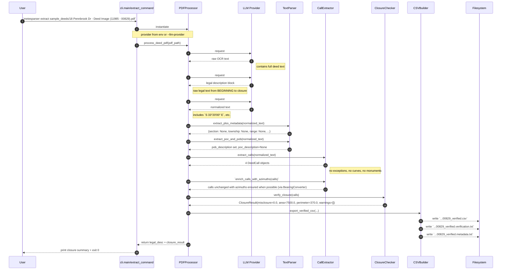
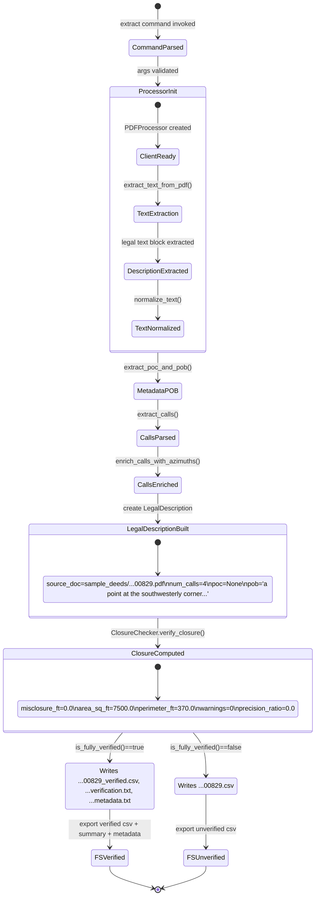

# Pennbrook sample (`11985-00829`) request-by-request workflow

This page captures one concrete run for:
`sample_deeds/18 Pennbrook Dr - Deed Image (11985 - 00829).pdf`

- `expected POB`: `a point at the southwesterly corner of Concord Drive (50 feet wide) and Pennbrook Drive (50 feet wide)`
- expected closure: `misclosure_ft = 0.0`, `area_sq_ft = 7500.0`, `perimeter_ft = 370.0`, `4 calls`

## 1) Mermaid flowchart (request-by-request stateful flow)

```mermaid
flowchart TD
  A["User: `metesparser extract sample_deeds/18 Pennbrook Dr - Deed Image (11985 - 00829).pdf`"] --> B["`cli.main()` parses command + configures logging"]
  B --> C["`extract_command()`\npdf=sample_deeds/...00829.pdf\noutput=sample_deeds/...00829.csv"]
  C --> D["`PDFProcessor(provider=None)`\nenv: METESPARSER_LLM_PROVIDER\nclient=OpenAI/Gemini"]
  D --> E1["`extract_text_from_pdf`\nLLM call #1"]
  E1 --> F1["raw OCR text captured\n(contains all page text)\ncontains 4 numbered calls block"]
  F1 --> E2["`extract_legal_description`\nLLM call #2\nInput=raw OCR text"]
  E2 --> F2["Legal description block (raw) extracted\nBEGINNING at a point ... to point and place of beginning"]
  F2 --> E3["`normalize_text`\nLLM call #3\nInput=raw legal desc"]
  E3 --> F3["Normalized text\nS 33°20'00\" E ... 4 numbered calls preserved"]

  F3 --> G1["`TextParser.extract_plss_metadata()`\n{section: None, township: None, range: None, principal_meridian: None, aliquot: None}"]
  F3 --> G2["`TextParser.extract_poc_and_pob()`\npob_description set\n`a point at the southwesterly corner ... Pennbrook Drive (50 feet wide)`\npoc_description=None"]

  F3 --> H["`CallExtractor.extract_calls()`\n4 call candidates parsed\nno exceptions\ncurve flags none"]
  H --> H1["Call 1 snapshot\ncourse=1, bearing_quadrant='S 33°20\' E'\nbearing_azimuth=146.666667\ndistance_ft=60.0\nalong='southwesterly line of Concord Drive'\nto='a point in the division line between Lots 46 and 47 ...'"]
  H --> H2["Call 2 snapshot\ncourse=2, bearing_quadrant='S 56°40\' W'\nbearing_azimuth=236.666667\ndistance_ft=125.0\nalong='said division line'\nto='point corner to Lot 50 said plan'"]
  H --> H3["Call 3 snapshot\ncourse=3, bearing_quadrant='N 33°20\' W'\nbearing_azimuth=326.666667\ndistance_ft=60.0\nalong='said Lot 50'\nto='southeasterly line of Pennbrook Drive'"]
  H --> H4["Call 4 snapshot\ncourse=4, bearing_quadrant='N 56°40\' E'\nbearing_azimuth=56.666667\ndistance_ft=125.0\nalong='said southeasterly line of Pennbrook Drive'\nto='the point and place of beginning'"]

  H --> I["`enrich_calls_with_azimuths()`\nNo missing azimuth corrections needed\n4 calls unchanged"]
  I --> J["`LegalDescription` object created (representative snapshot)\nsource_doc='18 Pennbrook Dr - Deed Image (11985 - 00829).pdf'\npoc_description=None\npob_description='a point at the southwesterly corner of Concord Drive (50 feet wide) and Pennbrook Drive (50 feet wide)'\ndistance_unit='feet'\nnum_calls=4\nall per-call note fields are None\noptional metadata fields (poc/sections/POC/metadata) are None"]
  J --> K["`ClosureChecker.verify_closure(calls)`\nCompute traverse, area, perimeter"]
  K --> L["`ClosureResult`\nmisclosure_x=0.0\nmisclosure_y=0.0\nmisclosure_ft=0.0\narea_sq_ft=7500.0\narea_acres=0.172131...\nperimeter_ft=370.0\nprecision_ratio=0.0\nclosure_passed=true\nangle_check_passed=true\ncurve_consistency_passed=true\nwarnings=[]\npoints=[(0,0),(32.970538,-50.129269),(-71.465438,-118.817891),(-104.435977,-68.688622),(0,0)]"]
  L --> M{`is_fully_verified()`}
  M -->|true| N["`CSVBuilder.export_verified_csv()`\nWrites\n`sample_deeds/...00829_verified.csv`\n`..._verified.verification.txt`\n`..._verified.metadata.txt`"]
  M -->|false| O["`CSVBuilder.legal_description_to_csv()`\nWrites unverified csv"]
  N --> P["CLI prints closure summary and exits 0"]
  O --> P
```

## 2) Sequence diagram (explicit external LLM calls)



## 3) UML-style state transition diagram


