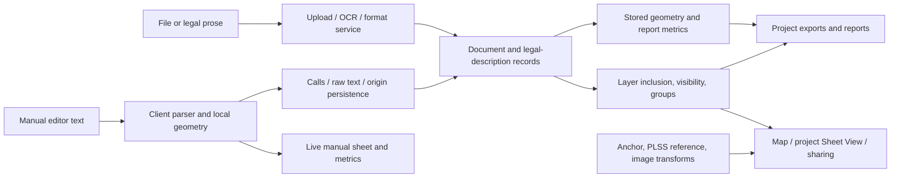

# BoundaryLogic: functional and client implementation reconstruction

Reviewed **2026-10-28** from the downloaded public site and captured browser/client artifacts. **319/319 URLs reviewed**, representing 318 distinct Markdown bodies: `/pricing` redirects to the same content as `/trace/pricing/`. Three smaller-model reviewers covered all pages; an independent pass verified every assignment, file identity and hash, and rechecked 16 consequential claims against 27 primary source files. Full-page reading is recorded in the individual review ledgers, rather than implied by a successful crawl.

This is a specification and evidence-backed reverse-engineering report. It does not establish complete backend recovery, authenticated end-to-end behavior, or numerical accuracy of the service. No application code was added to MetesParser.

## Deliverables and evidence

The evidence corpus is under `.firecrawl/boundarylogic-full-2026-10-28/`. These local files are intentionally not committed.

| Deliverable | Scope |
| --- | --- |
| [Workflow specification](../../.firecrawl/boundarylogic-full-2026-10-28/review/workflows-review.md) | 105 help/API pages: grammar, entities, workflows, numerical rules, permissions, billing and public API |
| [Product specification](../../.firecrawl/boundarylogic-full-2026-10-28/review/product-review.md) | 69 feature, guide, release, trust, legal and service pages |
| [Context and roadmap](../../.firecrawl/boundarylogic-full-2026-10-28/review/context-review.md) | 145 remaining pages: domain glossary, industries, editorial claims and product-scoped roadmap |
| [Review validation](../../.firecrawl/boundarylogic-full-2026-10-28/review/review-validation.md) | All 319 URL assignments, source hashes, selected claim checks and corrections |
| [Continuation validation](../../.firecrawl/boundarylogic-full-2026-10-28/review/continuation-validation.md) | Independent check of 77 new source-range entries, excerpt provenance and resumed claims |
| [Complete page ledger](../../.firecrawl/boundarylogic-full-2026-10-28/review/all-pages-reviewed.json) | Every reviewed URL, source hash, substantive takeaway and limitation |
| [Review manifest](../../.firecrawl/boundarylogic-full-2026-10-28/review/review-manifest.json) | Deliverable hashes and verification of 131 source-range entries across six static ledgers |
| [Parser code analysis](../../.firecrawl/boundarylogic-full-2026-10-28/review/parser-static-review.md) | Aliquot fallback, error handling, closure and diagnosis |
| [Persistence code analysis](../../.firecrawl/boundarylogic-full-2026-10-28/review/persistence-static-review.md) | Autosave, identity matching, deletions, export flushing and internal client endpoints |
| [Geometry code ledger](../../.firecrawl/boundarylogic-full-2026-10-28/review/geometry-static-evidence.json) | Exact source ranges and hashes for closure, area and local coordinate helpers |
| [Curves and corridors](../../.firecrawl/boundarylogic-full-2026-10-28/review/curves-corridors-static-review.md) | Curve precedence, offset construction, width resolution, caps and serialization |
| [Exports and placement](../../.firecrawl/boundarylogic-full-2026-10-28/review/exports-placement-static-review.md) | Actual client/server export paths, raster transforms, filtering and rotation |
| [Sharing and permissions](../../.firecrawl/boundarylogic-full-2026-10-28/review/sharing-permissions-static-review.md) | Guest-query lifecycle, reconnect behavior, roles and entitlement gates |
| [Focused REA analysis](../../.firecrawl/boundarylogic-full-2026-10-28/review/kernel-rea-review.md) | Successful syntax analysis of a source-traceable geometry excerpt; semantic limits retained |
| [Independent API example check](../../.firecrawl/boundarylogic-full-2026-10-28/review/api-example-check.json) | Recomputed geometry from the documentation's example calls |
| [Corpus guide](../../.firecrawl/boundarylogic-full-2026-10-28/README.md) | Original Markdown/HTML/JSON, URL index and full-text search instructions |

Evidence labels used below:

- **Documented:** the vendor's published description or worked example. Even unusually candid descriptions of defects remain vendor claims until independently reproduced.
- **Observed:** a previously captured browser action or screen. The saved app-entry capture redirects a fresh browser to `/login`, with Google, Microsoft, email-link and password choices. No authenticated project was exercised.
- **Static:** control flow or constants in the shipped client bundle, read without executing it. This establishes client implementation facts, not server responses or reachable runtime outcomes.
- **Inference:** a proposed architecture, consequence or independent design recommendation.

The client artifact is `https://app.boundarylogic.com/assets/index-CaPWRtUh.js`, SHA-256 `6444f1580504329b1a86c6e1ffbb53884a8f52e6a336481d68a4c95d4a5440e0`. Static ledgers retain Unicode-character and UTF-8-byte offsets because the minified lines are large. The browser-entry Evidence ID is `ev_fdb2ad176fb0c5106bb21d1fe99c278fa0535ff291313ddd37648584b90bf755`.

REA's original whole-bundle analysis exhausted its 1 GiB worker heap. This review retried with 4 GiB and a 180-second per-source deadline; it returned partial Evidence `ev_ab74fb23c700dfff4d6c9341030b7d5b68a4715741f2ee37bfd56b046c7ff93c` after timing out. [Retained partial Evidence](../../.firecrawl/boundarylogic-full-2026-10-28/review/static-partial-evidence.json). The focused static findings below come from direct inspection of the identified bundle ranges, not a claimed complete REA application graph.

The resumed pass then successfully analyzed an exact 61,022-byte geometry excerpt with REA: one source parsed, zero parse failures and 21,601 syntax nodes visited. Parent Evidence is `ev_8c6e4f5bb43e4b5f4b4446f8612ee6771680d8a2f4513f6f591bcdf2f42704dd`. Syntax examination completed for that excerpt; application coverage remains partial and semantics unknown, with 4,965 explicit semantic unknowns. The [focused analysis report](../../.firecrawl/boundarylogic-full-2026-10-28/review/kernel-rea-review.md) explains its provenance and limits.

## What BoundaryLogic is

BoundaryLogic separates three delivery modes:

1. **Trace:** a browser application for creating projects, extracting or manually entering descriptions, inspecting geometry, placing layers and delivering drawings.
2. **Partner API:** a sales-enabled integration interface for projects, document processing and structured/geometry results.
3. **Bulk Processing Services:** a scoped engagement involving intake, optional pilot, batch processing, confidence-ranked review and agreed deliverables.

The useful reconstruction is a system of related state models, not a single “AI plots a deed” operation. Text extraction, deterministic manual interpretation, geometry, geographic placement, visibility, export eligibility, billing and human review have separate behavior. [Platform](https://boundarylogic.com/platform/), [API workflow](https://boundarylogic.com/help/api/document-processing-workflow/), [BPS engagement](https://boundarylogic.com/help/bps/how-an-engagement-works/).

### Architecture inferred from documentation and client calls

The diagram is a behavioral decomposition, not a recovered deployment topology. The client exposes separate OCR/format and call-sync operations, while the help explicitly describes different live-editor and finished-report calculations. Database schema, queue implementation, extraction prompts, model routing, server geometry algorithms and transaction boundaries remain private/unknown.

### Domain model

| Entity | Reconstructable responsibilities |
| --- | --- |
| Account and team membership | Identity, active team, Owner/Admin/User, project access and seat state |
| Team | Projects, subscription, credit pool, categories, logo and policy |
| Project | Documents, anchor type/location, lifecycle status, labels, visible layer composition and exports |
| Document | Original file or prose, processing attempts/status, one or more legal descriptions, layer inclusion |
| Legal description / tract | Name, canonical ordered calls, manual source text, algorithm type, local origin, stored geometry/checks, placement and appearance |
| Call | Boundary/commencement/reference/omitted/derived role; line or curve parameters; monument annotation |
| Centerline width row | Inclusive course range, left/right offsets, start/end widths and step/taper rule |
| Layer and group | Order, effective visibility and lock; raster or description payload |
| Share | Project link/token, active state and guest presentation |
| Attempt and credit balance | Processing count and outcome distinct from tract count and export actions |

This is a conceptual model. Only exposed fields are recoverable; it is not the vendor's complete schema. [API outputs](https://boundarylogic.com/help/api/api-outputs/), [editor persistence](https://boundarylogic.com/help/trace/how-the-editor-saves/), [teams](https://boundarylogic.com/help/trace/teams-overview/).

## UI and state transitions

**Project dashboard:** filtering, stars, personal labels/team categories, Active/Completed/Archived scopes and role-gated operations. Archive and delete differ; hiding a layer differs from both. Project creation collects name, anchor/POC-versus-POB and input mode before final creation. Some labels/stars are applied afterward, so ancillary failure is a separate state. [Project creation](https://boundarylogic.com/help/trace/create-a-project/), [statuses](https://boundarylogic.com/help/trace/project-statuses/).

**Document workflow:** queued → uploading → OCR → plotting → complete/error. Text input presents a simpler processing stage. Auto-plot is configurable and **on by default**; a processed document can instead wait outside the project layers. Retries may accept additional guidance. Processing completion does not prove source completeness or correct location. [Queue](https://boundarylogic.com/help/trace/document-queue/), [processing failures](https://boundarylogic.com/help/trace/when-processing-fails/).

**Manual workspace:** editor, sheet canvas and results columns. Editor split defaults to 42%, constrained to 25–70% and persisted. It supports inline errors, forms for lines/curves, multi-tract headers, comments, call reordering, coordinate-to-call conversion, fit/zoom, tract selection and diagnosis. Its panel-hiding sheet mode is distinct from the project's read-only **Sheet View**. [Manual workspace](https://boundarylogic.com/help/trace/manual-plotting-workspace/), [Sheet View](https://boundarylogic.com/help/trace/sheet-view/). Split constants are also visible next to `Nan` in the captured code.

**Project map:** layers and groups control effective visibility and drawing order. Plot, raster and empty-map context menus differ. Lock restricts transforms; opacity zero is not exclusion from exported geometry. Delete keyboard shortcut hides a selected plot. Rotation is documented as visual and carried into PDF, rather than a rewrite of source bearings. These details need separate state fields rather than a single “enabled” flag. [Layer reference](https://boundarylogic.com/help/trace/manage-layers-reference/), [plot actions](https://boundarylogic.com/help/trace/plot-actions-reference/).

**Sharing:** Expert-level guest links expose read-only project presentation. The help says the guest loads the data once; revoking a link prevents a new load but does not erase data already loaded into an open tab. This is a documented limitation, not an independently tested access-control result. [Guest behavior](https://boundarylogic.com/help/trace/what-guests-see/), [share failures](https://boundarylogic.com/help/trace/share-link-not-working/).

**Static qualification from the resumed review:** the guest query has no polling and disables focus/cached-mount refresh, but inherits TanStack's reconnect-refetch default. An offline→online transition can therefore re-fetch share metadata and recheck active/error state. The documentation's “never checks back until reload” interpretation is too absolute. Separate map effects keyed to IDs may not refresh geometry URLs alongside metadata; that is an untested stale-display candidate, not a demonstrated revocation bypass. [Sharing code analysis](../../.firecrawl/boundarylogic-full-2026-10-28/review/sharing-permissions-static-review.md).

## Parsing and geometry

### Two interpretation paths

The deterministic manual language is richer in some directions than AI extraction. Manual interior angles and deflections are documented, while the AI/API limitations exclude internal-angle descriptions. Broad support claims must be qualified by input path; neither one engine nor identical acceptance rules can be assumed. [Syntax reference](https://boundarylogic.com/help/trace/deed-syntax-reference/), [API limitations](https://boundarylogic.com/help/api/limitations/).

The manual grammar includes:

- Quadrant bearings, cardinal axes, azimuths, signed deflections and interior angles. `45.3020` is packed degrees/minutes/seconds, not 45.3020 decimal degrees.
- Feet by default, with meter/chain/rod/pole/link/vara suffixes and compound distances.
- Named tract blocks, POC/POB declarations, local coordinates and coordinate-to-call inversion.
- Omitted calls, commencement ties, reference lines and comments as distinct roles.
- Radius/arc/chord/delta curves, curvature degree, entry tangent/chord/radial/ahead orientation, and limited missing-element solving.
- A single missing closing call or closing curve marked as derived.
- Open centerlines with symmetric/asymmetric widths and course-range step/taper tables.
- PLSS aliquot shorthand producing nominal local geometry; section placement is a separate operation.

The detailed grammar, examples, precedence, validations and edge cases are in the [workflow specification](../../.firecrawl/boundarylogic-full-2026-10-28/review/workflows-review.md#3-manual-parser-grammar-and-numerical-contract). This is sufficient to specify an independent parser, but not to assert identical behavior on every input.

### Closure, area and diagnosis: static corroboration

`C7t` filters omitted courses, uses arc length in perimeter, computes endpoint-minus-POB displacement and its Euclidean magnitude, and uses perimeter/misclosure for precision. It treats error **below 0.005 ft** as Closed; otherwise ratios below 1,000 are alert, below 5,000 warning, and the rest okay. Its solve flag forces the scalar misclosure to zero while departure/latitude errors are separately retained. `S7t` combines shoelace polygon area with signed circular-segment corrections. [Geometry ledger](../../.firecrawl/boundarylogic-full-2026-10-28/review/geometry-static-evidence.json).

The finished closure report uses a different published rating policy: Acceptable at ≥1:10,000, Marginal at ≥1:5,000, Poor below. **Different bands are intentional surface policy, not by themselves a math defect.** Documentation also shows different editor/report numerical results, including remainder bearing; that is a separate consistency issue. [Closure report](https://boundarylogic.com/help/trace/closure-report/), [how closure works](https://boundarylogic.com/help/trace/how-closure-works/).

`I7t` generates single-line candidates using distance correction, quadrant changes, reversal and degree-digit transposition. It reparses candidates, retains improvements with error under 10% of the original and returns the best five. The dialog explicitly asks for source review before Apply. These are geometric hypotheses, not recovered deed readings. Candidate acceptance's handling of parser errors remains a static concern requiring a controlled runtime test. [Diagnosis](https://boundarylogic.com/help/trace/diagnose-closure/), [parser analysis](../../.firecrawl/boundarylogic-full-2026-10-28/review/parser-static-review.md).

### Highest-impact correctness findings

| Finding | Evidence and limit | Consequence for an independent design |
| --- | --- | --- |
| Rejected source lines can coexist with Closed geometry | Vendor help explicitly describes omitted/unplottable lines and misleading closure; client parsing/closure flow supports separation. No authenticated reproduction. | Track source-call coverage separately from closure. |
| Ordinary comma-separated lot prose can fall through to a nominal section | Help gives a closed 640-acre example; static aliquot detector/expander confirms permissive lexical acceptance and unchanged section on unknown subdivision tokens. Captured code is broader than the documented three-piece trigger. | Reject unknown grammar; never replace it with nominal geometry silently. |
| Overlapping Count is not a measured overlap result | Explicitly stated in table help. | An unimplemented check must be unknown, not a zero that looks measured. |
| Source text, live geometry and saved geometry can diverge | Invalid tract saves are skipped; the live parser can still draw accepted courses. Static confirmation in `Nan.ot`. | Preserve invalid drafts with explicit last-valid geometry and revision identity. |
| Published API sample does not reproduce its metrics | Independent arithmetic on its four straight boundary calls gives 0.167681889 ft error, versus published 0.008 ft; perimeter agrees at 700.84 ft. | Treat sample responses as illustrative, not golden numerical fixtures. |
| Nominal PLSS is not surveyed section geometry | Published 5,280-ft section basis plus separate reference placement; static `pPe=5280` corroboration. | Label nominal assumptions and require authoritative irregular geometry where needed. |

Sources: [unplottable calls](https://boundarylogic.com/help/trace/when-a-call-will-not-plot/), [lot/block](https://boundarylogic.com/help/trace/lot-and-block-descriptions/), [table semantics](https://boundarylogic.com/help/trace/documents-and-descriptions-tables/), [PLSS calls](https://boundarylogic.com/help/trace/plss-calls/), [API example calculation](../../.firecrawl/boundarylogic-full-2026-10-28/review/api-example-check.json).

The independent sample calculation gives area **30,086.503476 sq ft** using shoelace closure to POB, versus the sample's **30,058.412677 sq ft**. This establishes inconsistency within that example, not a measured defect in the live API.

### Easements and placement

Centerlines are intentionally open. Their corridor requires width coverage, left/right direction semantics, appropriate curve offsets and end treatment; ordinary closed-boundary precision is inapplicable. Later overlapping width rows win with a warning. Station-based transitions and spirals remain unsupported in the reviewed path. The help discloses an editor/report corridor-area difference of about 23 sq ft in its worked example. [Corridor report](https://boundarylogic.com/help/trace/corridor-report/), [centerlines](https://boundarylogic.com/help/trace/easement-centerlines/).

Location is separate from shape: address, lat/lon, PLSS reference and AI-assisted location are different sources of an anchor. Image overlays use manual move/scale/rotation/opacity and lock, not a documented control-point adjustment with residuals. Geographic coincidence with imagery does not establish correct source interpretation. Static helpers `N9e`/`EPe` use a local 364,000-ft-per-degree/cosine-latitude approximation; this does **not** establish how all server exports are projected. [Placement](https://boundarylogic.com/help/trace/locate-a-description/), [overlays](https://boundarylogic.com/help/trace/image-overlays/), [geometry ledger](../../.firecrawl/boundarylogic-full-2026-10-28/review/geometry-static-evidence.json).

### Resumed pass: curve solving and corridor construction

The complete inspected `jF`/`o7t` curve solver uses parameter precedence rather than reconciling every supplied measurement. Degree of curvature can replace radius; selected delta/arc/chord branches determine sweep, and orientation resolves from chord/radial/tangent/prior/ahead inputs. Extra conflicting chord measurements can be ignored when a higher-precedence branch determines the curve. The two relative `1e-9` guards apply to particular selected branches, not a universal residual check. Major arcs are supported by the inspected math/rendering path, but that does not establish valid multi-revolution support.

The manual corridor is a **sampled polyline construction**, distinct from true SVG arc drawing and analytic circular-segment area for ordinary tracts:

- Curves sample at a maximum nominal **5° angular step**, with at least two segments; the general outline helper separately defaults to 8°.
- Left/right offsets are built from sampled tangents and miter joins. The miter factor is capped at **4**; width-step boundaries receive limited inner-side stitching.
- Taper widths interpolate along the relevant course/range; serialized canonical side widths are per-course averages. Full raw text is a separate representation, so this alone does not establish how the backend reconstructs a taper.
- The complete inspected local assembly performs no self-intersection repair, clipping or polygon union before absolute shoelace area.
- `END: OPEN` and `END: PERPENDICULAR` are accepted and assigned to `endTreatment`, but no use of that property was found beyond initialization/assignment in the captured bundle. The inspected corridor assembly closes the left edge against the reversed right edge in either case. This establishes no end-mode distinction on this **manual-client path**, not a claim about the private server report engine.

These findings were peer-checked against complete relevant functions and 19 hashed source ranges. The [curve/corridor report](../../.firecrawl/boundarylogic-full-2026-10-28/review/curves-corridors-static-review.md) supplies formulas, precedence, pseudocode, width-resolution details and remaining tests. A fixed angular sampling rule is not a fixed ground-distance error bound; an independent implementation should choose and report a distance-based approximation tolerance.

## Persistence: what the client actually does

The captured client shows a **800 ms debounce**, rescheduling after 400 ms if a save is busy. It stores raw per-tract text separately from canonical calls; a server call hash controls reuse of saved manual text. Its client comparison signature is algorithm type plus serialized calls, not a cryptographic content hash.

Saving matches blocks to descriptions by canonical call signature, then normalized name, then remaining array order. “Position” here means **ordinal block position**, not spatial proximity. A valid changed block may cause separate rename, call-sync/raw-text, and coordinate requests. An errored matched block skips those writes. Missing old blocks trigger deletion without a separate confirmation inside the save callback. There is no visible atomic multi-tract transaction in this client code.

PDF/general export tries to flush edits, but waits for an existing save for at most **2.5 seconds**; save callbacks catch errors internally, and navigation follows without a success-result check. Back/Import/Change-document handlers bypass that export flush. These support **candidate** stale-export/navigation/partial-save risks; export-route handling, outer navigation blockers, backend cleanup and actual failure behavior were not tested. Do not promote them to reproduced data-loss bugs. [Complete code review and 23 range-level evidence entries](../../.firecrawl/boundarylogic-full-2026-10-28/review/persistence-static-review.md).

## API reconstruction

Public documentation exposes seven method/path combinations: create/list/get project, submit text/file, include a document and get a legal description. Authentication is documented as `x-api-key`; missing/invalid/deactivated/rotated keys yield 401. File processing is described as synchronous and potentially several minutes. Public docs omit a complete request schema and disagree on base path: unprefixed `/projects`, sample `/api/v1/partner/projects`, and marketing plot examples must not be treated as tested equivalents. [Workflow and method table](../../.firecrawl/boundarylogic-full-2026-10-28/review/workflows-review.md#7-public-api-reconstruction).

The captured Trace client has a **separate internal** relative API surface: upload → OCR → format, CRUD document/legal-description, call-sync, manual-text, coordinates, visibility, lock, rotation and exports. Examples include `POST api/v1/documents/{id}/ocr` and `PUT api/v1/documents/legal-descriptions/{id}/calls`. These static client contracts are not a public partner API or proof of authorization/reachability. [Internal endpoint map](../../.firecrawl/boundarylogic-full-2026-10-28/review/persistence-static-review.md#bounded-internal-endpoint-map).

Unknown integration contracts include idempotency, retry charging guarantees, pagination, rate and size limits, signed-download TTL, cancellation/resume, MIME encoding, complete errors, exact geometry tolerances and export discretization. No API requests were made during this review.

## Exports, collaboration and commercial behavior

Trace documents PDF/DXF as free and credit-free; paid tiers add GIS formats and image download. Clipboard capture has a separate free path. Visible-layer composition determines project exports; selecting a tract is not an export filter. Guest share presentation does not imply download privileges. Raster opacity and vector inclusion must be distinguished. [Export formats](https://boundarylogic.com/help/trace/export-formats/), [layer groups](https://boundarylogic.com/help/trace/layer-groups/).

### Resumed pass: actual export production and placement

| Format | Inspected client generation path | Boundary of the finding |
| --- | --- | --- |
| DXF / GeoJSON | Rebuild through `POST api/v1/projects/{id}/dxf`; download returned file URL | Actual server geometry, units, revision, visibility and rotation policy remain untested |
| KML / KMZ / Shapefile | Same rebuild, fetch GeoJSON, convert/package in browser | Labels in the UI do not establish sidecar CRS, DBF field behavior or round-trip correctness |
| PNG | Capture current sheet DOM or map view | Browser rendering/CORS capture is untested |
| PDF | Capture view, upload `export.png`, request server PDF composition with image URL, text summary and settings | Actual server layout and screenshot/table consistency remain untested |

The PDF and vector requests inspected carry no explicit revision hash. PDF image and text summary are assembled separately. This refines the earlier stale-export concern but still does not prove a race in the live service. [Export code analysis](../../.firecrawl/boundarylogic-full-2026-10-28/review/exports-placement-static-review.md).

Three additional **static discrepancy candidates** require runtime validation: whole-project Sheet excludes image-overlay records and has no raster rendering branch in the inspected path despite feature-page promises; the PDF call-table preview flag is not represented in the unconditional summary payload; and a Sheet boundary-visibility setting is not consumed by the inspected renderer. Keep these separate from proven defects in generated files, which were not examined.

The map and Sheet do not use identical geometry inputs: the map fetches stored GeoJSON; the Sheet reconstructs local geometry from calls. Raster corners use spherical destination math, while sheet placement uses the local feet-per-degree approximation. Positive raster rotation adds to compass bearings, whereas local sheet rotation uses a Cartesian matrix around POC-or-POB. These type-specific conventions need explicit handling; they do not by themselves prove a rotation bug. The move/rotate UI and server export results remain separate evidence layers.

### Resumed pass: permissions are several independent gates

Client entitlement booleans require an explicitly active subscription; missing/loading/failed entitlements do not grant paid capabilities. Professional enables advanced formats, raster overlays, personal labels and full map workspace; Expert/legacy Team adds team-wide views, categories, shares, reports and PDF branding. Those gates combine with team role/reach and server-returned project `canEdit`, `canShare`, `canDelete` and `canArchive` flags.

Ordinary team Admin is distinct from platform/global admin. The captured organization-profile edit gate permits Owner or global admin, corroborating owner-only profile help over broader owner/admin branding prose. The public-share route is a separate read-only presentation outside the authenticated route hierarchy. Frontend gating and route structure **do not prove backend authorization, tenant isolation or public payload minimization**. [Sharing and permission matrix](../../.firecrawl/boundarylogic-full-2026-10-28/review/sharing-permissions-static-review.md).

The reviewed pricing snapshot lists Professional at $29.99/seat/month and Expert at $49.99, with pooled allocations and distinct add-on/PAYG rules. API and BPS have their own volume pricing. These are snapshot vendor policies, not a necessary part of plotting architecture or current purchase advice. Help says retries spend credits; the Terms contain a first-three-no-boundary-call exception. Preserve the discrepancy instead of choosing one universal charging rule. [Pricing](https://boundarylogic.com/trace/pricing/), [Terms](https://boundarylogic.com/legal/terms-of-service/), [product analysis](../../.firecrawl/boundarylogic-full-2026-10-28/review/product-review.md).

Current Trace, partner API and BPS capabilities cannot be merged into one feature list. For example, Trace markets KML/Shapefile exports while roadmap entries mark those formats as future **for the API**. BPS's offered confidence output differs from proposed broader confidence/credit features. Historical release descriptions explain some apparent contradictions. [Roadmap matrix](../../.firecrawl/boundarylogic-full-2026-10-28/review/context-review.md#roadmap-preserve-status-and-product-tags).

## Hosting and data handling: published claims only

Trust/legal pages describe Azure-managed hosting, encryption, external AI processing, customer ownership, no training use of customer content and support-request deletion. The newer subprocessor register adds Anthropic beyond an older OpenAI/Google-only statement. Personal-data residency wording has provider exceptions. These statements do not independently verify tenant isolation, encryption configuration, provider retention, backup deletion, model routing or any certification.

The reviewed site terms also contain restrictions concerning scraping and reverse engineering. They are recorded as part of the product review, without making a legal determination. This deliverable analyzes the downloaded artifacts and does not supply a copy of the product, reuse its assets, or test protected backend behavior. [Trust and contractual source review](../../.firecrawl/boundarylogic-full-2026-10-28/review/product-review.md#trust-data-lifecycle-and-contractual-constraints).

## Independent implementation blueprint

The requirements below are recommendations based on the reconstruction, not claims that BoundaryLogic implements them.

| Component | Behavior to implement | Acceptance boundary |
| --- | --- | --- |
| Source intake | Immutable source identity; OCR/extraction attempts; field/call provenance; rejected source segments retained | Every source course is accounted for; no fabricated bearings or silently substituted section |
| Deterministic parser | Explicit grammar and units; typed errors; separate boundary/tie/reference/derived calls | Invalid source stays invalid even when remaining geometry closes |
| Geometry kernel | One canonical line/curve/corridor engine with explicit tolerances and precision | Editor, report and export derive from the same revision and agree within declared tolerances |
| Review workspace | Source/call/segment linkage, errors, metrics and explicit candidate alternatives | Applying a candidate does not imply source verification |
| Draft persistence | Stable block IDs, immutable revisions, invalid drafts separate from last-valid geometry | Reopen preserves exact draft; slow/failed saves cannot silently export stale state |
| Transactional reconciliation | Repeat-safe create/update/delete, explicit partial-failure handling | Interrupted multi-tract saves neither orphan nor silently delete records |
| Placement and overlays | Source CRS/units/anchor/transform evidence; nominal/visual placements labeled | Map fit never changes verification; registration residuals required when claiming measured registration |
| Exports | Pin revision and visible layer set; preserve units, provenance and unresolved status | Successful rendering does not grant verified status |
| Collaboration | Explicit role matrix and revocation semantics | Test UI and API authorization separately; document open-tab behavior |

For MetesParser, retain its existing ownership boundaries: `mp-models` for contracts, `mp-parse`/`mp-bearing` for deterministic interpretation/math, `mp-verify` for verification, `mp-review` for orchestration/adapters and `mp-export` for rendering. Only `mp-ocr` should call models. BoundaryLogic's display thresholds are not a reason to change MetesParser's verified-export rule. This review does not claim gaps in concurrently modified MetesParser code; a separate current-code gap assessment would be required before implementation.

## What remains unknown

The public corpus supports a detailed functional specification and selected client control-flow reconstruction. It does not reveal proprietary OCR/extraction prompts, model/version selection, actual backend code/schema, server calculation implementations, calibrated accuracy, real output files, production access-control enforcement, concurrent-edit behavior or authenticated mobile/accessibility behavior. Screenshot descriptions across the corpus were reviewed as text; not every linked image/video was visually exercised.

To establish behavioral parity later, use an authorized account and synthetic fixtures to test: supported/unsupported grammar; the nominal-PLSS fallback; rejected-call completeness; curve/corridor calculations; slow/failed saves and navigation; actual GIS/PDF/DXF exports; and share/role transitions. Each result should retain input, version, source revision and observed output. None of these unrun gates is implied by the completed page review.
